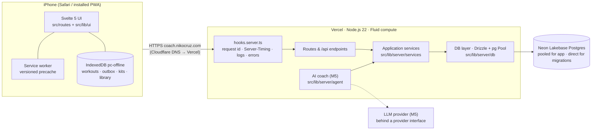
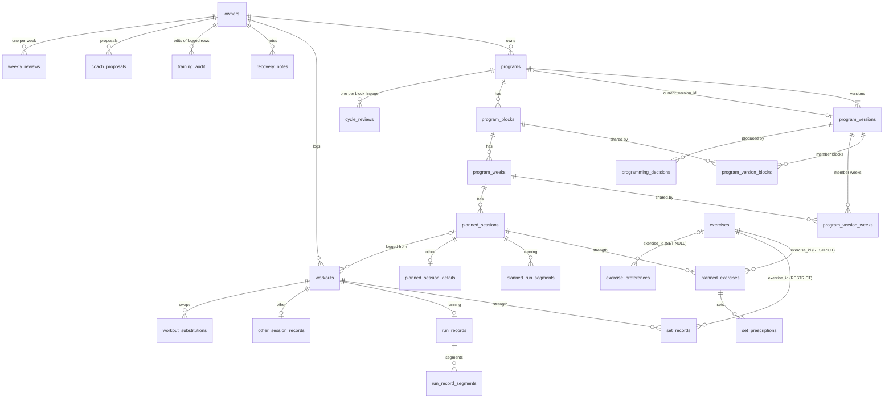
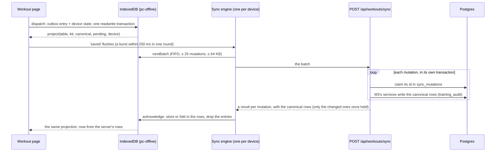
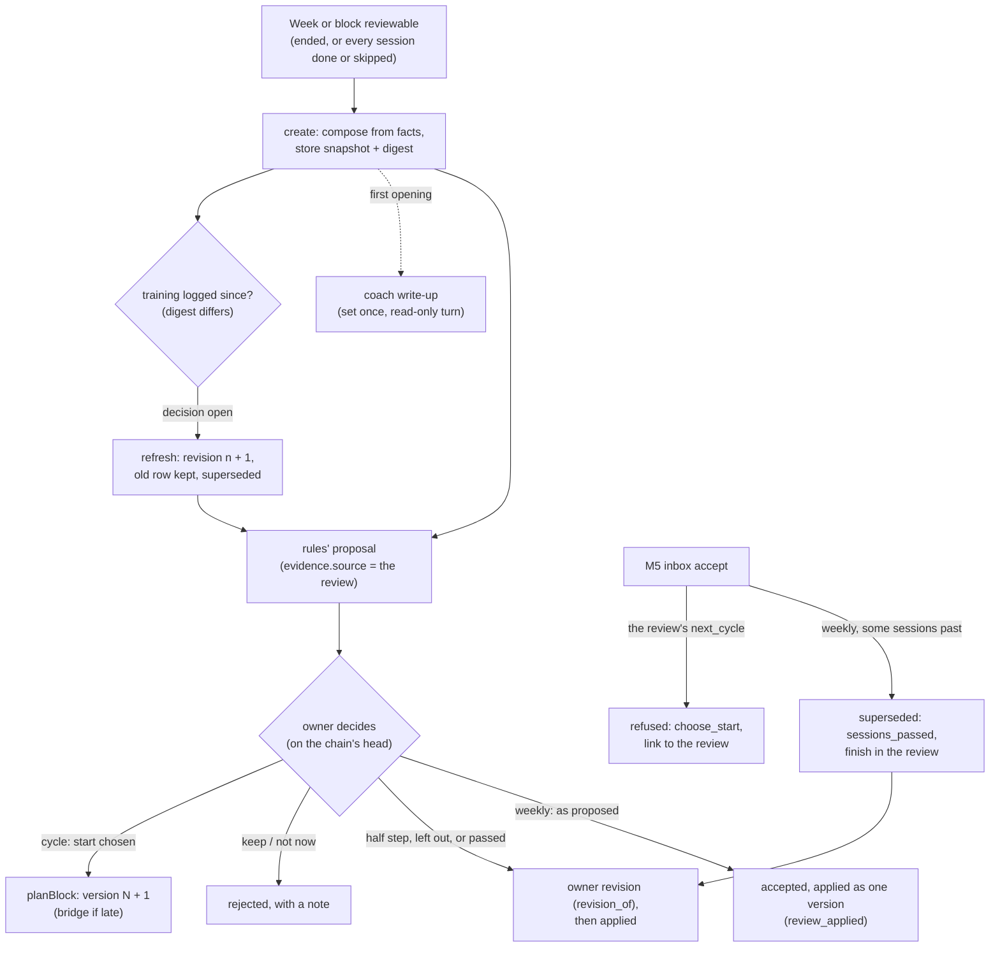

# Architecture

Performance Coach is a **single deployable SvelteKit application** backed by **PostgreSQL**. One
codebase serves the mobile web app (SSR + hydration + service worker), the JSON API under
`/api`, and — from Milestone 5 — the AI coach's server-side orchestration. There are no
microservices: one user, one app, one database (PRD §14).

Decisions and their alternatives are recorded as ADRs in [`docs/adr/`](adr/README.md).

## System overview



## Runtime request flow

1. Cloudflare DNS (DNS-only CNAME) resolves `coach.nikocruz.com` to Vercel; Vercel terminates TLS
   and serves immutable assets from its CDN (`/_app/immutable/*`, `cache-control: immutable`).
2. Dynamic requests run in one Node.js function (adapter-vercel). `hooks.server.ts`:
   - validates the environment once at startup (`init` → `getEnv()`; zod),
   - assigns a request id (`x-request-id` / `x-vercel-id` or a UUID) and opens an
     `AsyncLocalStorage` request context,
   - runs the **auth guard** (`src/lib/server/auth/guard.ts`, docs/security.md): refuses
     state-changing requests without the app's own `Origin`, resolves the session cookie to a
     live session (`locals.session`, one indexed query, `Server-Timing: auth`), and denies by
     default — pages redirect to sign-in, `/api/*` answers 401 — unless the route is on the
     public allow-list in `src/lib/server/auth/routes.ts`,
   - resolves the route, then adds `Server-Timing` (`db;dur=…`, `total;dur=…`, measured to the
     first byte), `x-request-id` and security headers incl. HSTS, and writes one JSON access-log
     line (SvelteKit itself adds the nonce-based Content-Security-Policy, `csp` in
     `vite.config.ts`; see docs/deployment.md),
   - `handleError` logs unexpected errors and records them in `app_errors`; streamed load
     failures are recorded by the load itself (`kind: streamed`).
   - Static and prerendered files never reach the hooks (CDN / `sirv`).
3. Routes call **services** (use-cases). Services call **repositories** in the DB layer, which
   use a small `pg.Pool` (reused across Fluid-compute invocations, `attachDatabasePool`).
4. The browser hydrates, registers the service worker, and (in the signed-in app shell) lazily
   loads `web-vitals`, which beacons Core Web Vitals to `POST /api/vitals` (owner-only). Uncaught exceptions, unhandled rejections and
   unexpected navigation errors are beaconed to `POST /api/client-errors` (`hooks.client.ts`,
   `src/lib/client/errors.ts`; at most 5 per page load, deduplicated, rate-limited server-side).

## Module boundaries

Folders are layers. Allowed dependencies point inwards. Every "Must not import" entry below is
**enforced by ESLint** (`no-restricted-imports` rules in `eslint.config.js`, one block per row;
`pnpm lint` fails on a violation). "May import" is guidance, not a rule.

| Folder                          | Responsibility                                                           | May import                                     | Must not import                                         |
| ------------------------------- | ------------------------------------------------------------------------ | ---------------------------------------------- | ------------------------------------------------------- |
| `src/lib/domain/`               | Pure, isomorphic training math (units, e1RM, RPE, plates, load). No I/O. | nothing outside itself                         | server, client, ui, Svelte/Kit, `node:*`, drivers       |
| `src/lib/server/db/`            | Drizzle schema, pool/client, repositories, migration helpers             | `domain`, `server/env`, `server/observability` | services, agent, ui, client, SvelteKit                  |
| `src/lib/server/services/`      | Application use-cases shared by routes **and** the agent                 | `db`, `domain`, `observability`                | agent, ui, client, SvelteKit                            |
| `src/lib/server/agent/`         | AI coach: providers, the agent loop, tools, the output gate (M5)         | `services`, `domain`                           | `db` (tools go through services), ui, client, SvelteKit |
| `src/lib/server/auth/`          | Passkey auth (SimpleWebAuthn), sessions, recovery, the request guard     | `services`, `db`, `env`, `observability`       | ui, client                                              |
| `src/lib/server/forms/`         | Form actions for routes: owner check, JSON payload → service, failures   | `services`, `domain`, SvelteKit                | `db`, `pg`, `drizzle-orm`, agent, ui, client            |
| `src/lib/server/observability/` | Logger, request context, Server-Timing helpers (a leaf)                  | Node built-ins only                            | db, services, agent, auth, ui, client, SvelteKit        |
| `src/lib/server/mail/`          | Mail to the owner only: one interface, Resend over fetch, a test outbox  | `observability` (the logger) only              | db, services, agent, auth, forms, ui, client, SvelteKit |
| `src/lib/client/`               | Browser-only code: RUM, preferences, offline store/sync (M4)             | `domain`                                       | server, ui                                              |
| `src/lib/ui/`                   | Design-system primitives, tokens, fonts, icons                           | `domain` (types)                               | server                                                  |
| `src/routes/`, `src/hooks*`     | Pages, layouts, `/api` endpoints, request hooks                          | everything above                               | `server/db`, `pg`, `drizzle-orm` (call a service)       |

SvelteKit additionally refuses to bundle any `server/` module into client code.

Two domain packages are server-only at runtime: `src/lib/domain/exercises/` (the catalogue) and
`src/lib/domain/programming/` (the generator). UI, client code, route components, universal
loads and the rest of the domain may only `import type` from them. ESLint enforces it with a rule
of its own (`@typescript-eslint/no-restricted-imports`), so the layer rules above stay in force on
the same files (`scripts/server-only-imports.test.ts`), and `pnpm budgets` fails if the
catalogue's header is in any client chunk.

`src/lib/domain/analytics/` (M6) is server-only at runtime too, except the modules listed in
`CLIENT_SAFE` (`periods.ts`, `period-names.ts`, `types.ts`). A test enforces it rather than
ESLint, because it follows imports through every module a browser file can reach: see
"Analytics (M6)".

### Why services sit between routes and the database

The coach (M5) must be able to do everything the UI can — read history, propose changes,
record a review — **through the same code paths**, with the same validation. Putting use-cases
in `services/` (not in route files) makes the agent's tools thin adapters over services, keeps
routes thin, and makes business logic testable without HTTP. Repositories accept an `Executor`
(the database _or_ a transaction), so services decide transaction boundaries and integration
tests can wrap each test in a rolled-back transaction.

A transaction is one connection, and a connection runs one query at a time, so code handed an
`Executor` awaits its queries in turn and never starts several together (`Promise.all` over one
`db`). node-postgres 8 still queues such queries but has deprecated it for pg@9, and integration
tests fail on any query sent to a busy connection (`tests/integration/one-query-per-client.ts`).
A route may still await several services together when none is handed a transaction: the pool
gives each of their queries its own connection.

### Lifecycles

Which states a record can be in, and what may follow what, is declared as a typed transition
table next to its status list (`src/lib/domain/lifecycle.ts`; the registry is
`src/lib/domain/lifecycles.ts`). [docs/lifecycles.md](lifecycles.md) is generated from the tables
and [the lifecycles as data ADR](adr/NNNN-lifecycles-as-data.md) records why. Edit the table
first, then `pnpm lifecycles`.

## Data

- **PostgreSQL 16+** everywhere: Neon Lakebase Postgres 18 in production/preview, Postgres 18 in
  CI (service container, to match production), local Postgres 16+ in development and tests.
- **Drizzle ORM** schema in `src/lib/server/db/schema/`; **committed SQL migrations** in
  `drizzle/` generated by `pnpm db:generate` and applied by `pnpm db:migrate`
  (`scripts/db-migrate.ts`, advisory-locked, direct connection). `drizzle-kit push` is never used.
- Connections: `DATABASE_URL` (pooled, Neon `-pooler` host) for the app; `DATABASE_URL_UNPOOLED`
  (direct) for migrations and backups.
- M1 tables: `app_errors` (server incidents) and `web_vitals` (RUM, attributed per screen via
  `path` + `route_id`). M2 auth tables: `owners` (exactly one row), `passkey_credentials`,
  `auth_sessions` (token hashes), `email_sign_in_links` (hashes), `recovery_codes` (hashes), `webauthn_challenges` (single-use),
  `used_setup_tokens` (hashes of spent setup tokens), `auth_events` (audit log) and `auth_rate_limits` (DB-backed counters); see docs/security.md. CI's `pnpm db:drift` fails when the schema changes without a committed
  migration. M2 training-profile tables: see "Training profile (M2)" below. M3's programs,
  prescriptions, exercise library, training log and coaching memory: see "Training model (M3)"
  below. M4's sync ledger (`sync_mutations`) and `pain_reports`: see "Offline workouts (M4)".
  M6's `strength_week_rollups` and the review columns: see "Analytics (M6)" and "Reviews and
  replanning (M6)".

## Training profile (M2)

What the coach knows about the athlete (PRD §2, §3). The same services serve the Profile edit
screens, onboarding and, from M5, the coach, so a change is validated and recorded the same way
whoever makes it.

### Data model

Fourteen tables, created by `drizzle/0004_training_profile.sql` (`schema/profile.ts`); every
row is keyed by `owner_id`. Catalogue keys (disciplines, lifts, equipment) are validated by the
services, not CHECKed, so a new key needs no migration.

- `athlete_profiles`: one row with the name, units, time zone (added by
  `drizzle/0006_profile_time_zone.sql`: the owner's calendar day), birth year, nutrition phase,
  weight target, "I don't know my 1RMs" (`baselines_unknown`) and onboarding progress (the steps
  completed and skipped, and when it finished).
- `body_weight_entries`: a dated series; the latest entry is the current weight, and a save on
  the same calendar day replaces that day's entry.
- `training_goals`: event or general goals with their disciplines. `priority` ranks the open
  (active or paused) goals, unique and contiguous from 1, and is null once a goal is achieved or
  dropped.
- `training_goal_events`: the append-only history of every goal change, status change,
  re-ranking and deletion, as a JSON snapshot with its source. `goal_id` has no foreign
  key (only `owner_id` does), so it outlives a deleted goal.
- `discipline_experience`: level, years and sessions a week, one row per discipline.
- `strength_baselines`: optional 1RMs, either `measured` (tested, competition) or `estimated`
  (from a set, an estimate); the database refuses a measured row from an estimating source. A
  change supersedes the current row (`superseded_at`) instead of overwriting it.
- `running_profiles` and `race_results`: weekly volume, runs a week, longest run, easy pace and
  recent races, times in seconds. `muay_thai_profiles`: sessions and sparring a week, fights.
- `equipment_profiles`: gym type, available and home equipment.
- `injuries`: body area, side, severity, movements to avoid, notes, active or resolved.
- `exercise_preferences`: likes and dislikes in the owner's words; since
  `drizzle/0015_coaching_memory.sql` linked to the exercise library, with their source.
- `schedules` and `schedule_commitments`: days a week, which days, time of day, session length,
  and fixed commitments such as Muay Thai classes.

### Services and shared schemas

- `src/lib/domain/profile/` is pure: the catalogue, the types, the zod/mini schemas
  (`schemas.ts`, one per section, `SCHEMAS` by name) and the onboarding rules (`onboarding.ts`:
  the steps, which apply, which are optional, where to resume).
- `src/lib/server/services/profile/` holds the use-cases: `get…`/`save…` per section, the goal
  operations (create, update, set status, delete, reorder, history) and onboarding (advance,
  complete). Each validates its input with the same schema the browser uses and throws
  `ProfileInputError` (field errors by dotted path) or `ProfileNotFoundError`. Every write names
  its source (`onboarding`, `profile`, `coach`). A save that replaces a set of rows runs in one
  transaction and takes its section's advisory lock first, so two saves of one section queue
  instead of interleaving. Experience, injuries and exercise preferences keep the ids of rows
  that match; race results are deleted and reinserted.
- `src/lib/server/db/repositories/profile.ts` is plain data access over an `Executor`.

### The save path

1. A screen edits a draft in a `SectionForm` (`src/lib/client/section-form.svelte.ts`).
2. On save, `src/lib/client/profile-form.ts` validates it with the shared schema, loaded on
   demand (warmed on idle once the screen is interactive), and shows field errors without a
   round trip.
3. It posts the section as JSON in a `payload` field to a form action of the current page
   (same origin, so the CSRF Origin check passes).
4. The action (`src/lib/server/forms/profile.ts`) calls the service, which validates again and
   stays the authority: an input error becomes `fail(400, { errors })` keyed by field path, a
   record that no longer exists `fail(404)`. Profile's `save` answers with the section as
   stored; onboarding's redirects to the next step.

Goals save one at a time from a sheet (`saveGoal`, `deleteGoal`, `reorderGoals`), so the Goals
section has no whole-section `save`.

### Routes

- `/(app)/profile/[section]` edits one section. `src/lib/server/forms/sections.ts` maps each key
  to its load and save, `src/lib/ui/profile/sections.ts` lists them for Profile, and
  `src/lib/ui/profile/editors.ts` is the lazy registry of editors;
  `tests/integration/profile/edit-route.test.ts` keeps the three in step.
- `/onboarding/[[step]]` is one URL per step (`/onboarding` is the welcome). Each step edits
  the Profile section of the same name (the welcome edits name and units) through the same
  services, recorded as `onboarding` changes. Continue saves and marks the step done, Skip is
  refused by the services on a required step, Back and Finish later save without marking it
  done, and the review's Start coaching needs an open goal and a schedule. Loads have no side
  effects: resuming means the furthest step advanced.
- Today (`/(app)/today`) shows a "finish setting up" card until onboarding is complete, then
  the open goals by rank and the shape of the week.

Why it is built this way (docs/performance.md, measured): every route node and param matcher
costs every route initial JS, because the app entry lists every node, so there is one dynamic
route each for Profile editing and onboarding, with no matcher (an unknown key is a 404 from
the load and from every action). Editors load through the registry after the screen renders,
never statically, and the screen never reaches an editor on the server (`import.meta.env.SSR`), so
SvelteKit links none of the editors' CSS into the page.

## Training model (M3)

What the plan is, why it is that, and what the owner did (PRD §4, §5, §7, §9). Planned history
is never overwritten: every edit is a new program version ([ADR 0010](adr/0010-program-versioning.md)).

### Modules

| Module                                 | Holds                                                                                  |
| -------------------------------------- | -------------------------------------------------------------------------------------- |
| `src/lib/domain/training/`             | The vocabulary, the program-plan contract (`types.ts`, `schemas.ts`), words, metrics   |
| `src/lib/domain/exercises/`            | The exercise catalogue as pipe tables (`catalogue/{lower,upper}.ts`) and the matcher   |
| `src/lib/domain/programming/`          | The generator: input, stages, rules per area, decision templates, interference, hashes |
| `src/lib/server/services/exercises/`   | The library: list, look up, create and retire the owner's own, resolve free text       |
| `src/lib/server/services/programs/`    | Store a plan, read the program, revise it, the owner's edits, alternatives             |
| `src/lib/server/services/programming/` | Preview the generated program, then build it as version 1                              |
| `src/lib/server/services/training/`    | The training log (`log.ts`), history reads (`history.ts`), preferences, shared errors  |
| `src/lib/server/db/queries/`           | The history and program query builders, run by repositories and by `pnpm db:explain`   |

The services modules are imported by path; `services/index.ts` re-exports none of them. The
catalogue and the generator are server-only at runtime (see "Module boundaries").

### Data model

Twenty-four tables from `drizzle/0008_program_versions.sql` to
`drizzle/0016_history_plan_indexes.sql`, plus the library link on M2's `exercise_preferences`.
Later milestones alter some of them (M4's `0017_log_gaps.sql`: assisted sets, bounded time sets
and a substitution's slot and soft delete; M5's `0025`/`0026`: the coach proposals' columns and
guards); this section describes them as they are now.
Every row reaches `owners` through a foreign key (`owner_id`, or a parent that has one), except
`exercises` (below).



- **Programs** (`schema/programs.ts`): `programs` is the head row, one active per owner
  (`programs_owner_active_uq`). A version's tree is its rows in `program_version_blocks` and
  `program_version_weeks`; blocks, weeks and sessions carry a `lineage_id` that every copy keeps,
  so screens address a session by lineage (`/train/session/<lineage>`, `?v=n` for an older
  version). `programming_decisions` records each choice: kind, rule key, summary, a non-empty
  why, who decided (owner, coach or rules), the version it produced and the lineages it touched.
  Status is planned, skipped or moved on each version's rows; 'completed' is derived from a
  completed workout with the session's `planned_lineage_id`, so logging never makes a version.
  Goals and commitments are referenced by uuid with no foreign key.
- **Prescriptions** (`schema/prescriptions.ts`): `planned_exercises` (ordered, with superset
  numbers and a swap's `substituted_from_exercise_id`) → `set_prescriptions`;
  `planned_run_segments` (ordered, with repeat groups); `planned_session_details` (1:1, a jsonb
  metrics array). An exercise a plan prescribes cannot be deleted (ON DELETE RESTRICT).
- **Exercise library** (`schema/exercises.ts`): one table, two kinds of row, told apart by
  `exercises_kind_ck`. Catalogue rows have a `key` and no owner; every `pnpm db:migrate` seeds
  them from `CATALOGUE` (`src/lib/server/db/seed/exercises.ts`, one upsert by key under the
  migration lock): a changed entry is updated in place, a removed key is retired (`retired_at`),
  never deleted, so ids stay stable and stored programs keep resolving. Custom rows have an
  `owner_id` and no key, unique per owner by lower-cased name. That `owner_id` has **no foreign
  key**: the integration cleanup truncates `owners` with CASCADE, and a foreign key would empty
  the library mid-suite. Every query scopes custom rows to their owner, and the owner row is
  never deleted.
- **Training log** (`schema/training-log.ts`): `workouts` (kind strength, run or other) →
  `set_records`, `run_records` (1:1) → `run_record_segments`, `other_session_records` (1:1), and
  `workout_substitutions`; beside them `recovery_notes` and `training_audit`. Device ids
  (`client_id`, `client_mutation_id`) are unique. `weight_kg` and each pace are generated columns
  through M1's exact factors; distances are stored in metres (5 mi is 8046.72 m). Workouts, sets
  and substitutions are deleted softly (`deleted_at`).
- **Coaching memory** (`schema/coaching.ts`): `exercise_preferences` links each like or dislike
  to the library (`exercise_id`, one per owner and exercise) with its `source`.
  `coach_proposals` have a closed lifecycle; M5 ties each to its conversation and guards it
  (`drizzle/0026_coach_proposals_guards.sql`). `weekly_reviews` hold one live review per owner
  and Monday, and `cycle_reviews` one per block lineage, with their superseded revisions beside
  them (M6's columns: "Reviews and replanning (M6)").

### Immutability and the audit

Postgres enforces it, with triggers from custom migrations (ADR 0010):

- Program and prescription tables (`drizzle/0009_program_history_guards.sql`,
  `drizzle/0012_prescription_history_guards.sql`) refuse every UPDATE and DELETE. A program head
  may change only `status`, `archived_at` and a forward `current_version_id` to one of its own
  versions. An edit therefore copies the affected week's subtree into version _n + 1_ (new ids,
  same lineages) and shares every other week through the membership rows; the head moves by
  compare-and-set, so a stale base is a `ProgramConflictError`, never a lost update.
- Logged tables (`drizzle/0014_training_log_guards.sql`) accept owner edits. An UPDATE that
  changes the content stamps `updated_at` and writes one `training_audit` row (before, after,
  owner, and the actor from `app.actor`, 'owner' when unset); one that changes nothing leaves
  no trace. DELETE is refused, and `training_audit` refuses UPDATE and DELETE.
- Each refusal is a `restrict_violation` (23001). TRUNCATE (which fires no row triggers), a disabled
  trigger and `session_replication_role` bypass the guards; server code may use none of them,
  only test and reset code (docs/security.md).

### CHECK policy

CHECKs cover the closed lists (program, plan, workout and proposal status; deciders; load kind
and basis; measure; skill level; load type; workout kind; audit action; preference source),
the scales (RPE 1–10 in half steps, heart rate, recovery 1–5) and coherence (both rep bounds
or neither, a moved session has `moved_from`, one measure per prescribed set, at least one per
performed set). The prescription CHECKs are
built from `PRESCRIPTION_LIMITS` and `LOAD_NEEDS`, so they and the contract's zod schemas agree.
Open lists (decision kind, rule key, phase, week kind, session type, set role, segment and
other-session kinds, substitution reason, pattern, muscles, tags) are validated by the services
and the catalogue's `parseTable`, so a new key needs no migration.

### The training log's replay contract (for M4)

`src/lib/server/services/training/log.ts` freezes it; M4's outbox and the coach write through it:

- **Creates** (a workout, set, substitution, run, run segment, other session, recovery note) are
  keyed by the device id: a workout by its `client_id`, its run or other session by the same,
  the rest by `client_mutation_id`. A replay writes nothing and returns the stored row with
  `duplicate: true`; the stored row always wins, and `matches` says whether the replay carried
  the same values.
- **Edits** carry absolute values, never differences, and M4 applies one row's mutations in
  order, so an edit needs no id of its own. An edit that changes nothing returns
  `changed: false`, with no `updated_at` bump and no audit row.
- **Deletes** are soft and idempotent: deleting a deleted set returns it unchanged and writes
  nothing; editing a deleted set is refused (`TrainingLogConflictError` 'deleted').
- A substitution stays on the workout; only 'Never prescribe this again' writes a dislike.

### History queries and their indexes

Each read is one builder in `src/lib/server/db/queries/{history,programs}.ts`, explained by
`pnpm db:explain` on a two-year dataset, which fails a plan that skips its index on a large
relation. `HISTORY_INDEXES` names each history builder's index.

| Query                                             | Index                                                                     |
| ------------------------------------------------- | ------------------------------------------------------------------------- |
| An exercise's sets, newest first; last N          | `set_records_exercise_history_idx` (keyset on `performed_at`, `id`)       |
| Best e1RM, one exercise or all                    | `set_records_exercise_e1rm_idx`                                           |
| Rep maxes (heaviest set per rep count)            | `set_records_exercise_rep_max_idx`                                        |
| Sets in a range (weekly hard sets)                | `set_records_owner_performed_idx`                                         |
| Runs in a range (weekly mileage)                  | `workouts_owner_kind_started_idx`                                         |
| Workouts in a range; active workouts              | `workouts_owner_started_idx`                                              |
| A workout's sets in order                         | `set_records_workout_order_idx`                                           |
| A run's segments in order                         | `run_record_segments_run_order_idx`                                       |
| 'Completed' by lineage                            | `workouts_planned_lineage_idx`                                            |
| Completed workouts, 20 a page (History)           | `workouts_owner_started_idx` (keyset), `set_records_workout_order_idx`    |
| A version's weeks and a week's sessions by day    | `program_version_weeks_pk`, `planned_sessions_week_day_idx`               |
| A session, or an edit's touched nodes, by lineage | `planned_sessions_lineage_idx`, `planned_exercises_lineage_idx`           |
| Version history, 20 a page, with decisions        | `program_versions_program_number_uq`, `programming_decisions_version_idx` |
| A row's audit trail                               | `training_audit_row_idx`                                                  |

A read across all exercises drives a LATERAL from the small `exercises` table, so each
exercise probes its own index range.
A query repeats its partial index's predicate, and descending columns are `DESC NULLS FIRST`.

### The generator

`src/lib/domain/programming/` is pure: no clock, randomness or I/O. `buildProgrammingInput`
normalises the M2 profile; `generateProgram(input, { startsOn, firstPlannedDay })` runs the
stages in `STAGES` (`generate.ts`) on one draft, each recording its choices through a
`DecisionLog`:

demand → blocks → commitments → strength → running → other → placement → volume → loads →
progression → timefit

- Numbers live in one file per area, `rules/{days,blocks,strength,running,volume,loads,defaults}.ts`,
  and the interference thresholds in `interference.ts` (`INTERFERENCE`, `INTERFERENCE_RULES`,
  and `BLOCKS_EDIT`, which blocks nothing, so a broken rule only warns). Words live in one
  template file per area, `decisions/templates/*.ts`, with a template for every
  `DECISION_KINDS` entry, so a 'why' is never empty.
- 'Not told yet' defaults (`rules/defaults.ts`, `DEFAULTS`), each recorded as a
  `default_assumed` decision naming its Profile section: any day; no time of day; 60-minute
  sessions; the commercial-gym preset; a commitment at moderate intensity for 60 minutes (90
  for Muay Thai); new to each discipline; time-based runs with no running specifics; technical
  Muay Thai sessions; maintenance when every goal is paused.
- Session length: `timefit` runs last, so the sets volume and progression add are checked in
  every week. Every generated session fits `sessionMinutes` except the long run
  (`BEYOND_SESSION_LENGTH`; `LONG_RUN_EXCEEDS_SESSION` caps it too when false), which says so in
  a decision, commitments, which keep their own length, and a strength session whose top sets
  alone run over. Trimming drops accessories, then back-off sets, never a top set.
- The plan is parsed with `programPlanSchema` before it is returned, so a broken plan is a
  `GeneratedPlanError`, never a stored version.
- **Fingerprint and reproduction** (`random.ts`): `fingerprint` hashes (FNV-1a 64) the canonical
  input, `catalogueDigest` (the library's content) and `GENERATOR_ID`; it ignores timestamps,
  row ids, the start dates and the time zone. Every version stores `starts_on` and
  `first_planned_day`; only the version a generator built also stores the generator id,
  fingerprint, digest and input snapshot (a revised version omits them). The same snapshot,
  digest, generator id, `startsOn` and `firstPlannedDay` give the same plan, byte for byte. Bump `GENERATOR_ID` whenever a rule, stage or
  template could change a plan.
- **Preview and build** (`services/programming`): `previewProgram` stores nothing; `buildProgram`
  regenerates and stores version 1 only when it matches what the owner saw, otherwise a
  `ProgrammingConflictError` (`profile`, `library` or `start_date`) writes nothing. Week 1 starts
  next Monday by default (`DEFAULT_PROGRAM_START`); 'This week' plans from today. A repeated
  build returns the stored program; another build is refused while one is active.

### Services the coach (M5) calls

The coach's tools are thin adapters over these services, with the same validation as the
screens ("Why services sit between routes and the database"):

- `services/programs`: `getCurrentProgram`, `getTrainingWeek`, `getTodayPlan`,
  `getPlannedSession`, `getVersionHistory`, `getVersionWeek`, `alternativesFor`, and
  `reviseProgram` with the edits built on it (`moveSession`, `skipSession`, `swapExercise`,
  `adjustPrescription`, `adjustRunSegment`, `adjustSessionDetails`).
- `services/programming`: `previewProgram` and `buildProgram`.
- `services/training/history`: `getExerciseHistory`, `getLastPerformances`,
  `getPersonalRecords`, `getWeeklyMuscleVolume`, `getWeeklyMileage`, `getSessionsInRange`.
- `services/training/log` and `services/training/preferences` (`recordExercisePreference`).
- `services/exercises`: `listExercises`, `resolveExerciseName`, `createCustomExercise`.

Each takes `deps.source` ('owner' unless told otherwise; the coach's tools pass 'coach'), which a
revision records as its decider and an edit of the log as its audit actor. docs/agent-architecture.md maps the tools onto them.
Since M6 the coach's records and analytics tools read M6's engine instead of the history reads
above ("Analytics (M6)").

## Offline workouts (M4)

A set is confirmed on the device first, a reload offline restores the workout exactly, and
Postgres never stores a change twice (PRD §9, §15, §18). The design and its alternatives are
[ADR 0012](adr/0012-offline-workout-sync.md); the wire format is `src/lib/domain/workout/`.



### Modules

| Module                              | Holds                                                                                        |
| ----------------------------------- | -------------------------------------------------------------------------------------------- |
| `src/lib/domain/workout/`           | The contract, timers, the projection and its per-kind reducer tables, logging rules, schemas |
| `src/lib/client/workout/`           | The store, the restore read, outbox rules, the sync engine, reconcile and tabs, start        |
| `src/lib/server/services/workouts/` | The sync dispatcher (`sync.ts`), its `apply/*` handlers, canonical reads, kit, history       |
| `src/lib/ui/workout/`               | The logging components (`ExerciseCard`, `SetRow`, `SetLogger`, `RestTimer`, `SyncPill`…)     |
| `src/routes/workout/`               | The three pages, their `Shell.svelte`, views, sheets and the Fix registry (`fix/`)           |

The domain and client folders list their modules in their own READMEs.

### Data

- **`sync_mutations`** (`drizzle/0018_sync_ledger.sql`, guards in `0019`): one row per applied
  mutation id, written in the same transaction as its effect, and one per id the owner discarded,
  so a late copy of it answers `duplicate`. Rows never change, are never deleted and are not
  pruned in M4 (about 15k a year).
- **`pain_reports`** (`drizzle/0021_pain_reports.sql`, guards in `0022`): where it hurt, how
  badly, what the owner chose (`stopped`, `substituted`, `ended_workout`) and a note, keyed by
  the device's id. M3's logged-table guards apply: edits are audited, DELETE is refused. A pain
  report is never an exercise preference; the coach reads the last 28 days of them.
- `drizzle/0017_log_gaps.sql` added what M4 logs to M3's training log: time, distance and
  assisted sets, missed reps independent of reps, and the substitution's slot.

Endpoints, all owner-only and never cached: `POST /api/workouts/sync` (≤ 64 KB, 413 above),
`GET /api/workouts/[id]` (canonical rows), `GET /api/workouts/active` (workouts in progress on
any device), `GET /api/workouts/kit` (`?lineage=` to start, `?session=` to adopt),
`GET /api/exercises` (the library, revalidated by its ETag) and `GET /api/exercises/[id]/history`.

### Frontend

- `/workout` (strength, the empty state and the start), `/workout/run` and `/workout/session` are
  prerendered, public and data-free, outside `(app)`: no tab bar or rail, and they apply the safe
  areas themselves. Each imports only its own view, so `pnpm budgets` counts each kind's whole
  path; a page holding another kind's workout replaces itself with that kind's route
  (`src/lib/client/workout/kinds.ts`).
- Reducer tables per kind, each with the device actions: strength (core, custom exercises, sets,
  structure; `reducers/tables.ts`), run (core, run) and session (core, other). Tables are merged
  through a `/* @__PURE__ */` call, so no route ships another kind's reducers.
- Before the app starts, `/workout` paints the current exercise card from a copy in localStorage
  (`prepaint.ts`, `pc:workout-prepaint:v1`, #410); the hydrated view replaces it.
- First render reads IndexedDB raw (`restore.ts`), never creating `pc-offline`. The store's write
  path and the page's one sync engine load together on idle (`online.ts`); every saved dispatch
  and every other tab's write flushes it.
- Refused changes open the Fix registry (`src/routes/workout/fix/registry.ts`): every mutation
  type has an editor that re-sends under the same id, a one-tap rewrite, or Discard only.
- The resume bar (`src/routes/(app)/ResumeBar.svelte`) probes IndexedDB on idle on every app
  screen and never creates the database; Today saves the kits of today's sessions so Start works
  with no signal, and is the only other screen that may create it.
- A finished or abandoned workout leaves IndexedDB once its last change is acknowledged; until
  then the page restores it as completed.
- Layouts for the phone and for a 1440 × 900 window (two centred columns, the rest timer docked
  in the main column, History's list beside its detail) are in docs/design-system.md,
  "Responsive layout → Screens".

## Coach (M5)

The coach answers from the owner's own records through the same services the screens use, and
changes nothing without the owner's Accept. The design, the loop and the tools are in
docs/agent-architecture.md, ADR 0013 and ADR 0014; the tools catalogue is docs/coach-tools.md.

### Modules

| Module                                                            | Holds                                                                                                                                                                                         |
| ----------------------------------------------------------------- | --------------------------------------------------------------------------------------------------------------------------------------------------------------------------------------------- |
| `src/lib/domain/coach/`                                           | Pure: vocabularies, SSE events, the answer grammar, sources, the tool catalogue, pricing, budgets, safety; server-only parsers (markdown, proposals, diff, grounding, memory format, summary) |
| `src/lib/server/agent/`                                           | The loop: `coach.ts` (composition root), `turn.ts`, `orchestrator.ts`, `policy.ts` (output gate), `direct.ts`, `rollover.ts`, `launch.ts`                                                     |
| `src/lib/server/agent/provider/`                                  | `LlmProvider`: the mock, request validation, the Anthropic provider (the only runtime SDK import), selection                                                                                  |
| `src/lib/server/agent/prompt/`, `tools/`, `memory/`, `proposals/` | The system prompt and cache layout; the 26 tools in seven group files; the memory preamble; the drafter                                                                                       |
| `src/lib/server/services/coach/`                                  | Threads, runs, proposals and their `apply/*` appliers, memory, notes, `shared.ts` (`toolRuntime`)                                                                                             |
| `src/lib/server/db/schema/coach.ts`, `agent-runs.ts`              | Threads, messages (the `json` transcript), notes; runs, model calls, tool calls; the proposals' M5 columns are in M3's `coaching.ts`                                                          |
| `src/lib/client/coach/`                                           | `stream.ts` (the SSE reader over `fetch`), `turn.svelte.ts` (a turn's state), `proposals.ts`                                                                                                  |
| `src/lib/ui/coach/`                                               | Answer blocks, the composer, notices, the proposal card and its sheet (docs/design-system.md)                                                                                                 |
| `src/routes/(app)/coach/`                                         | The Coach screen (`[[thread]]`) and the Proposals inbox (`proposals/[[id]]`)                                                                                                                  |
| `src/routes/api/coach/`                                           | `turns` (SSE), `runs` (with cancel), `threads`, `proposals/[id]`, `memory`; all owner routes                                                                                                  |

The agent never imports `server/db`, types included (ESLint): it reads only `serialTools` from
`ToolContext`. Migrations `0023` to `0027` add the conversations, the proposals' columns, their
guards and the coach indexes.

## Analytics (M6)

Every number on Progress, in the reviews, on Today's 'This week' and in the coach's analytics
tools comes from one engine, so a screen and an answer never give one figure two values or two
verdicts (PRD §10). The trend method is [ADR 0015](adr/0015-trend-classification.md) and the
charts are [ADR 0016](adr/0016-hand-built-charts.md). `src/lib/domain/README.md` documents each
function.

### Layers

| Module                                        | Holds                                                                                                                                              |
| --------------------------------------------- | -------------------------------------------------------------------------------------------------------------------------------------------------- |
| `src/lib/domain/analytics/`                   | Pure definitions: periods, series and statistics, the trend classifier, strength, prescribed against actual, running, adherence, workload, metrics |
| `src/lib/server/db/queries/analytics.ts`      | The fact queries, each defined once, with `ANALYTICS_INDEXES` naming the index each is shaped for; `repositories/analytics.ts` runs them           |
| `src/lib/server/services/analytics/`          | The facts loader, the dashboards, the overview, one exercise, records, targets, the week so far and the coach's analytics                          |
| `src/lib/ui/analytics/`, `src/lib/ui/charts/` | Tiles, verdicts, context and the period picker; the chart kit, its frame and table twin, and the lazy chart bodies                                 |
| `src/routes/(app)/progress/`                  | The overview and the Strength, Running and General views (`?view`, `?period`), exercise detail and the reviews                                     |

Like the rest of the domain, `domain/analytics` is pure (today is always an argument), imported
by path (there is no index file), with no zod and no runtime import of `domain/programming` or
`domain/exercises`. It is server-only at runtime except `CLIENT_SAFE` (`periods.ts`,
`period-names.ts`, `types.ts`): `scripts/analytics-client-imports.test.ts` walks every runtime
import from every browser-reachable file and fails, naming the chain, when one reaches any other
analytics module. Screens receive results, never definitions. The walk is
`scripts/import-graph.ts`, the one runtime-import walker, which M3's
`scripts/training-index-imports.test.ts`, `scripts/chart-body-imports.test.ts` and the workout and
secret-scan tests share: static imports, re-exports and string-literal `import()`, in `.ts` files
and every `<script>` block of a `.svelte` file, with `import type` erased and
`import { type X }` still counted.

Any change to a definition bumps `ANALYTICS_VERSION` (`domain/analytics/version.ts`) in the same
PR. A stored review keeps the version that computed it, and its inputs digest includes it.

### Which workouts count

Only completed, undeleted workouts: set, session and segment facts join their workout and keep
`COUNTED_STATUS` ('completed') with `deleted_at` null (`queries/analytics.ts`), so an abandoned or
unfinished workout never reaches a PR, a total, a review or a coach answer. M3's `setsInRange`
(weekly hard sets) follows the same rule. M3's `bestE1rms` and `repMaxes` deliberately still read
every undeleted set: they feed the start kit's 'prior bests' and the exercise history sheet,
which show what was lifted. `services/analytics/records.ts` records the difference, and the coach's
`get_personal_records` reads M6's records, not M3's.

### Periods and the week in progress

A period (`4w`, `12w`, `26w`, `52w`, `all`; `DEFAULT_PERIOD` `12w`) is whole Monday-to-Sunday weeks
that have ended, on the owner's calendar (`periods.ts`). Totals, averages, trends and comparisons
read those weeks only, so a Wednesday never looks like a decline. The previous period is as many
complete weeks before; `all` has none, and is bucketed by month once it spans more than
`MONTHLY_AFTER_WEEKS` (104) weeks. Today's week is apart: 'This week so far', compared with the
same days of last week (`sameDaysLastWeek`), marked 'so far' on charts and tiles, and never in a
total or a verdict. A verdict reads `trendWindow(period)`: the period's own weeks from 12 weeks
up, else the last `TREND_MIN_WEEKS` (12) complete weeks, which the tile names ('Trend over the
last 12 weeks'). Both are the M6 plan's defaults and still open questions for the owner.

### Facts, targets, services and trends

- **The facts loader** (`services/analytics/facts.ts`): one per request and owner. Each kind
  (sets, counted workouts, runs with their segments, prescriptions, the plan, recovery check-ins,
  baselines and races) is read at most once, when first asked for, one query at a time even when
  several are asked for together, so it may run on a transaction. A range longer than
  `MAX_RANGE_DAYS` is read in consecutive windows (`windowsOf`), rows are kept by the owner's day
  they fell on, and each read is timed as `analytics` in `Server-Timing`. Services that compose
  (the overview) share one loader through `sharedFacts`.
- **Targets** (`services/analytics/targets.ts`): a week's hard-set range per muscle group comes
  from the stored input of the lowest-numbered generated version that plans its block (version 1
  for M3's first blocks, the planning version for later ones), through volume.ts's
  `hardSetBand`, scaled by the week's volume factor. Changing today's goals or nutrition phase
  never rewrites a past week. A program with no stored input shows its planned line only
  (`NO_STORED_TARGET`).
- **Services**: `getProgressOverview` (verdicts per discipline, KPI tiles, headline series, and
  when each insight appears), `getStrengthDashboard`, `getRunningDashboard`,
  `getGeneralDashboard`, `getExerciseAnalytics`, `getStrengthRecords`, `getMuscleTargets`,
  `getWeekSoFar` (Today), and the coach's `getWeeklyTrainingSummary`, `getTrainingLoad` and
  `getPerformanceTrends`, which read the dashboards rather than computing anything again. Every
  figure carries its metric id, kind, method and caveat from the catalogue (`metrics.ts`), its
  availability, its comparison and its verdict with the weeks it read, plus display strings in the
  profile's units (`format.ts`, `UNITS_FROM` 'profile': the plan's open question, defaulted to
  the units workout logging uses).
- **Trends**: `classifyTrend` (`domain/analytics/trend.ts`): a Theil–Sen line, a Mann–Kendall p,
  noise as 1.4826 × MAD, and a real trend only at p < 0.05 with a change of at least the larger of
  the metric's minimal practical change and twice the noise, standing with any one outlier left
  out. Six points over 21 days before any verdict. ADR 0015 has the measured error rates.
- **Closed weeks, summed once** (`strength_week_rollups`,
  `drizzle/0032_strength_week_rollups.sql`, `services/analytics/strength-weeks.ts`): one derived
  row per owner and Monday holding the Strength view's sums for that week. Database triggers
  (`drizzle/0033_strength_week_rollups_stale.sql`) mark a week stale on any write that could
  change it; a sync batch that completes or deletes a
  workout rewrites its weeks (`refreshStrengthWeeks`), and every `pnpm db:migrate` backfills the
  rest (`backfillStrengthWeeks`). A read uses a rollup only when it is current for the time zone,
  analytics version and digest version, and not split; otherwise it sums the facts, so a figure is
  the same either way.

### Server-rendered views and performance

- Each Progress view and each review kind is a string-literal import that `+page.ts` awaits on the
  server and in the browser alike, with no SSR guard: the server renders the verdicts and every
  number, so Progress reads without JavaScript, period links work as plain links, and nothing
  moves at hydration.
- What is not the answer in words loads after hydration in a chunk of its own: Overview's tiles
  and charts, each view's trends, the exercise page's trends and the weekly review's body
  (`trends.ts`, `review-body.ts`). The server sends that part as static markup, which the page
  keeps as sent (`ServedInPlace`) until its code arrives and hydrates it in place; a failed chunk
  keeps the markup readable, with a notice and Retry.
- Charts are hand-built (ADR 0016): `ChartFrame` server-renders the title, the context, the
  one-sentence summary and the table twin and reserves the plot box; the body (`CHART_BODIES` in
  `ui/charts/bodies.ts`, behind `import.meta.env.SSR`) draws into it after hydration, so no chart
  code is initial JS and no chart CSS is render-blocking.
- Page loads are measured by `pnpm db:explain` on two years of data
  (`scripts/explain/page-load.ts`), devalue serialisation included, gated at a median of
  `PAGE_LIMIT_MS` (300 ms) and `PAGE_DATA_LIMIT_BYTES` (32 KB gzip) of page data; every fact
  query's plan is gated on its index (`scripts/explain/analytics.cases.ts`). docs/performance.md
  has the measurements.

## Reviews and replanning (M6)

A weekly review judges one week and proposes next week's changes; a cycle review judges one block
and plans the next. Both are computed by code alone and stored before the coach writes a word, so
a coach outage never blocks one (PRD §11). Planning a later block is
[ADR 0017](adr/0017-planning-later-blocks.md).

| Module                                                                      | Holds                                                                                                                                         |
| --------------------------------------------------------------------------- | --------------------------------------------------------------------------------------------------------------------------------------------- |
| `src/lib/domain/programming/review/`                                        | The snapshots and their schemas, the findings brief, the inputs digest, the weekly and cycle compositions, next week's ops and the directives |
| `src/lib/domain/programming/results.ts`, `next-block/`                      | Progression from results; the next block's dates, input and generator                                                                         |
| `src/lib/server/services/reviews/`                                          | The store, the weekly and cycle reviews' create, refresh and read, deciding next week and the next cycle                                      |
| `src/lib/server/services/programs/next-block.ts`, `week-changes.ts`         | Storing a planned block as a version; what a review changed in a week, for Train's notice                                                     |
| `src/lib/server/services/coach/apply/next-cycle.ts`                         | Every inbox path for a `next_cycle`, and applying the review's own                                                                            |
| `src/lib/server/agent/reviews/narrate.ts`, `src/routes/api/reviews/narrate` | The coach's write-up (docs/agent-architecture.md)                                                                                             |
| `src/routes/(app)/progress/reviews/[[key]]`                                 | The reviews list and one review (`w-<Monday>` or `c-<id>`), with its form actions                                                             |



### Lifecycle, snapshots and supersession

- **When**: a week is reviewable once it has ended, or earlier once every planned session is
  completed or skipped (`EARLY_REVIEW`); a block once its last planned week has ended, or earlier
  on the same rule. Before that, creating it is a not-reviewable error with the day it will be.
  Today and Progress lead with a prompt when one is due (`progress/review-prompt.server.ts`).
- **Create** runs in one transaction under the owner's review lock (an advisory lock), and is
  idempotent: the live review is returned as it is. It loads the facts (the week and its
  `TRAILING_WEEKS`, or the block and the weeks before it for the ACWR), the targets and the goals,
  composes the snapshot and brief, stores them, and proposes.
- **Snapshots** keep the figures as they were (`snapshot.ts`, `cycle-snapshot.ts`), versioned by
  `snapshot_version`. A row written before M6 (version 0) or at a version this code does not
  know reads as legacy, with its summary; a current-version row that breaks its schema throws
  `SnapshotError` naming the path rather than show figures it cannot trust.
- **Out of date**: `inputs_digest` (`digest.ts`) hashes every fact the review read with its
  `updated_at`, each workout's status and `ANALYTICS_VERSION`. When today's digest differs the
  review says 'Computed before N later changes'. Refresh writes revision n + 1 and keeps the old
  row (`superseded_at`, `superseded_by`), only while its decision is open, and for a cycle review
  only while no next block is planned from it. An undecided head proposal is superseded as
  `review_refreshed` before the new one is proposed.
- **Postgres guards it** (`drizzle/0029_reviews_guards.sql`): identity and content never change,
  a superseded row never changes, the write-up (with its run, thread and time), `proposal_id` and
  `next_version_id` are set once from null, a cycle review whose next block is planned is never
  superseded, and DELETE is refused. `superseded_by` is DEFERRABLE INITIALLY DEFERRED, so a
  refresh marks the live row with the next revision's id, then inserts it, in one transaction, and
  the partial live unique index never sees two live rows.

### Proposals, provenance and late decisions

- A review's proposal is an M5 `coach_proposals` row: a `program_adjustment` for a weekly review,
  a `next_cycle` for a cycle review. `evidence.source` (`RulesProvenance`) names the review and
  its revision, so M5's card, the inbox, memory and `get_coach_proposals` say the review's rules
  proposed it, never the coach.
- An owner's change is a revision (`revision_of`), with `modifiedBy: 'owner'` and, when changes
  for passed sessions were dropped, `trimmed: n`. The review's decision is always read from the
  head of that chain (`proposalHead`, `decisionState`), never from the proposal it first linked.
- **Late decisions**: deciding next week on any day of it applies only the chosen changes whose
  sessions are still ahead (`opsStillAhead`, the same split `acceptProposal` uses); the rest are
  dropped and counted ('2 changes were for sessions already past'). Accepting such a proposal from
  M5's inbox supersedes it as `sessions_passed` and links to the review, which applies the rest as
  the owner's revision. If nothing chosen is still ahead, nothing is written.

### Next week and the next block

- **Next week as edit ops** (`programming/review/next-week.ts`): the results rules
  (`results.ts`) and interference checks turned into M3's edit ops on generated sessions still
  ahead, each with its why and a half step, at most `MAX_NEXT_WEEK_OPS` (12, M5's limit); anything
  an op cannot express is listed as not proposed, with its reason. A late week (next week has
  ended), a boundary week (next week is the cycle review's) and a week no program plans store no
  proposal, and say why. Applying writes one version through M5's applier, with a
  `review_applied` decision that Train's notice reads (`services/programs/week-changes.ts`).
- **The next block as a version**: the cycle review's directives (`review/directives.ts`) feed
  `generateNextBlock` over today's profile overlaid with what the block showed
  (`next-block/input.ts`). The review screen previews each start on offer (this week or next
  Monday, `DEFAULT_NEXT_BLOCK_START` this week); 'Start next block' posts the chosen start with its
  preview's fingerprint, and a fingerprint that no longer matches is a conflict that writes nothing
  (`services/reviews/next-cycle.ts`). `planBlock` stores the block as version N + 1 under the
  program head's lock, sharing the base's planned blocks and rewriting the outline after it.
- **Bridges**: a start k ≥ 1 weeks after the reviewed block ended stores a 'Between blocks' block
  of k unplanned weeks with no sessions (`next-block/dates.ts`); before an event the build is
  shortened instead, so the event's date never moves. Workouts logged in a bridge are off-plan.
- **The first-day rule**: no new-block session may fall before the day the owner chose to start,
  so 'this week' from a Wednesday plans nothing on Monday or Tuesday.
- **The inbox paths for `next_cycle`** (`services/coach/apply/next-cycle.ts`): the review's own
  proposal, or a revision of it, is refused with 'Choose when it starts in your cycle review'
  (`choose_start`) and a link; a coach's `next_cycle` for a block with no review is accepted and
  waits for the review (`NEXT_CYCLE_AWAITS`), which folds it in as clamped overrides; one for a
  block whose review is undecided is folded into an owner revision of its head
  (`folded_into_review`); once the next block is planned, every other open `next_cycle` for that
  block is superseded as `cycle_planned`.

### The review table additions

`drizzle/0028_reviews_provenance.sql` gives `weekly_reviews` and `cycle_reviews` (M3's tables):

- `snapshot_version`, `analytics_version`, `inputs_digest`, `revision` (from 1),
  `superseded_at` and `superseded_by` (a self-reference), and the write-up's `narrative_run_id`,
  `narrative_thread_id` and `narrated_at` beside M3's `narrative`.
- `weekly_reviews.program_id` and `version_id`: the program and version that planned the week.
- `cycle_reviews.version_id`, `block_starts_on` and `block_ends_on`: the version that planned the
  block and its dates; `next_version_id` (M3's) names the version planned from it.
- One live row per week (`weekly_reviews_owner_week_uq`) or block (`cycle_reviews_block_uq`),
  partial on `superseded_at is null`, a unique index per revision beside each, and
  `cycle_reviews_owner_ends_idx` for the list. CHECKs hold a current-version row coherent (a
  digest, an analytics version, the block's dates); rows written before M6 stay valid.

`drizzle/0030_review_superseded_reasons.sql` adds `review_refreshed`, `folded_into_review`,
`sessions_passed` and `cycle_planned` to the proposals' superseded reasons, each with its label
(`SUPERSEDED_REASON_LABEL`).

## Frontend

- Svelte 5 (runes) with SSR for every app route; client-side navigation afterwards; view
  transitions between tabs.
- Mobile-first shell (`src/routes/(app)/+layout.svelte`) with a fixed bottom navigation,
  safe-area insets and `viewport-fit=cover`. Dark is the designed default; light and "auto"
  are supported (`docs/design-system.md`).
- Responsive in CSS only (docs/design-system.md, "Responsive layout"): one `AppNav` is the glass
  bottom bar below 1024 px and a left rail from there, with `<main>` centred beside it at the
  width a screen declares with `data-layout` (readable, wide or split). The page-agnostic rules,
  those widths and the rail's brand mark, live in `src/lib/ui/styles/layout.css`, so the shell's
  own stylesheet stays inlined into every app page; the mark masks `static/brand/mark-track.svg`
  and `static/brand/mark-arc.svg`, precached with the other static files. No browser code reads
  the window's size (`scripts/layout-rules.test.ts`), so SSR paints the final layout.
- PWA: web manifest, PNG/SVG icons, and a SvelteKit service worker
  (`src/service-worker/index.ts`) that precaches what offline needs (the shell, the workout pages
  and `/offline`, `scripts/lib/precache-scope.ts`) + static assets, copying the hashed files the
  previous version cached instead of downloading them again, caches other build files on first
  use, deletes old caches and claims open pages on activate (so the first visit is already
  controlled), and
  serves navigations from the network with the prerendered `/offline` screen as the fallback.
  It **never stores dynamic HTML, `__data.json` or `/api/*`**: pages are `private, no-cache`
  because they carry personal data, and a stored copy would outlive sign-out and show stale
  state as live. Workout data lives in IndexedDB instead ("Offline workouts (M4)"). Prerendered
  pages, the three workout pages among them, are served from the precache whatever their query
  string, so `/workout?start=…` reloads offline.
- Offline UX: the `/offline` screen renders inside the app shell (tabs keep working), and
  `src/hooks.client.ts` marks network failures during client-side navigation (`__data.json`
  fetch errors) as `offline`, so `src/routes/ErrorView.svelte` shows the designed offline state
  with the nav instead of a 500. A connectivity notice appears in the shell while offline.
  Covered by `e2e/offline.e2e.ts`.
- Code splitting per route; heavy, interaction-only UI (e.g. the plate calculator) is loaded on
  intent. Budgets are enforced in CI (`docs/performance.md`).

## Observability

| Signal           | Where                                                          |
| ---------------- | -------------------------------------------------------------- |
| Access logs      | one JSON line per request (stdout → Vercel logs)               |
| Request timing   | `Server-Timing` header (`db`, `total`)                         |
| Server errors    | JSON log + `app_errors` row with request id and stack          |
| Browser errors   | beacon → `POST /api/client-errors` → `app_errors` (`client`)   |
| Real-user vitals | `web_vitals` table (LCP, INP, CLS, TTFB, FCP; p75 on Profile)  |
| Health           | `GET /api/health` → `{ ok, db, version, dbLatencyMs }`         |
| Auth audit       | `auth_events` (sign-ins, passkeys, recovery, sessions, limits) |

Sentry can be added later behind the optional `SENTRY_DSN` variable; nothing requires it.

## Environments

`development` (local `vite dev`), `test` (Vitest + Playwright against local/CI Postgres),
`preview` (Vercel preview deployments + a Neon branch), `production` (Vercel production +
Neon main branch). See `docs/environment.md`.

## Repository layout

```
.github/            CI and backup workflows; PR template; Dependabot
docs/               product requirements, architecture, ADRs, guides
drizzle/            committed SQL migrations + drizzle-kit snapshots
e2e/                Playwright specs and global setup
scripts/            db setup/migrate/reset, budgets, Lighthouse, icons, restore, Vercel build guard
src/
  hooks.server.ts   request pipeline (auth guard, timing, logs, errors, headers)
  service-worker/   PWA service worker (own tsconfig)
  lib/{domain,server,client,ui}
  routes/           pages and /api endpoints
static/             manifest, icons, the rail's brand mark (brand/), robots.txt
tests/integration/  Vitest integration tests (real Postgres)
neon.ts             Neon config-as-code (Postgres only)
vercel.json         Vercel project config: build command (migrate, then build), no Git deploys of main until the M2 cutover
```
