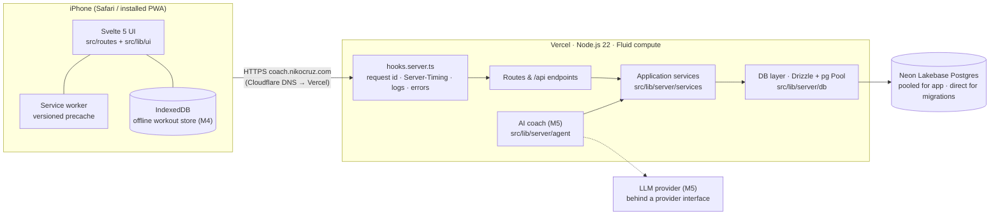

# Architecture

Performance Coach is a **single deployable SvelteKit application** backed by **PostgreSQL**. One
codebase serves the mobile web app (SSR + hydration + service worker), the JSON API under
`/api`, and — from Milestone 5 — the AI coach's server-side orchestration. There are no
microservices: one user, one app, one database (PRD §14).

Decisions and their alternatives are recorded as ADRs in [`docs/adr/`](adr/README.md).

## System overview



## Runtime request flow

1. Cloudflare DNS (DNS-only CNAME) resolves `coach.nikocruz.com` to Vercel; Vercel terminates TLS
   and serves immutable assets from its CDN (`/_app/immutable/*`, `cache-control: immutable`).
2. Dynamic requests run in one Node.js function (adapter-vercel). `hooks.server.ts`:
   - validates the environment once at startup (`init` → `getEnv()`; zod),
   - assigns a request id (`x-request-id` / `x-vercel-id` or a UUID) and opens an
     `AsyncLocalStorage` request context,
   - runs the **auth guard** (`src/lib/server/auth/guard.ts`, docs/security.md): refuses
     state-changing requests without the app's own `Origin`, resolves the session cookie to a
     live session (`locals.session`, one indexed query, `Server-Timing: auth`), and denies by
     default — pages redirect to sign-in, `/api/*` answers 401 — unless the route is on the
     public allow-list in `src/lib/server/auth/routes.ts`,
   - resolves the route, then adds `Server-Timing` (`db;dur=…`, `total;dur=…`, measured to the
     first byte), `x-request-id` and security headers incl. HSTS, and writes one JSON access-log
     line (SvelteKit itself adds the nonce-based Content-Security-Policy, `csp` in
     `vite.config.ts`; see docs/deployment.md),
   - `handleError` logs unexpected errors and records them in `app_errors`; streamed load
     failures are recorded by the load itself (`kind: streamed`).
   - Static and prerendered files never reach the hooks (CDN / `sirv`).
3. Routes call **services** (use-cases). Services call **repositories** in the DB layer, which
   use a small `pg.Pool` (reused across Fluid-compute invocations, `attachDatabasePool`).
4. The browser hydrates, registers the service worker, and (in the signed-in app shell) lazily
   loads `web-vitals`, which beacons Core Web Vitals to `POST /api/vitals` (owner-only). Uncaught exceptions, unhandled rejections and
   unexpected navigation errors are beaconed to `POST /api/client-errors` (`hooks.client.ts`,
   `src/lib/client/errors.ts`; at most 5 per page load, deduplicated, rate-limited server-side).

## Module boundaries

Folders are layers. Allowed dependencies point inwards. Every "Must not import" entry below is
**enforced by ESLint** (`no-restricted-imports` rules in `eslint.config.js`, one block per row;
`pnpm lint` fails on a violation). "May import" is guidance, not a rule.

| Folder                          | Responsibility                                                           | May import                                     | Must not import                                         |
| ------------------------------- | ------------------------------------------------------------------------ | ---------------------------------------------- | ------------------------------------------------------- |
| `src/lib/domain/`               | Pure, isomorphic training math (units, e1RM, RPE, plates, load). No I/O. | nothing outside itself                         | server, client, ui, Svelte/Kit, `node:*`, drivers       |
| `src/lib/server/db/`            | Drizzle schema, pool/client, repositories, migration helpers             | `domain`, `server/env`, `server/observability` | services, agent, ui, client, SvelteKit                  |
| `src/lib/server/services/`      | Application use-cases shared by routes **and** the agent                 | `db`, `domain`, `observability`                | agent, ui, client, SvelteKit                            |
| `src/lib/server/agent/`         | AI coach: provider interface, tools, orchestration (scaffold in M1)      | `services`, `domain`                           | `db` (tools go through services), ui, client, SvelteKit |
| `src/lib/server/auth/`          | Passkey auth (SimpleWebAuthn), sessions, recovery, the request guard     | `services`, `db`, `env`, `observability`       | ui, client                                              |
| `src/lib/server/forms/`         | Form actions for routes: owner check, JSON payload → service, failures   | `services`, `domain`, SvelteKit                | `db`, `pg`, `drizzle-orm`, agent, ui, client            |
| `src/lib/server/observability/` | Logger, request context, Server-Timing helpers (a leaf)                  | Node built-ins only                            | db, services, agent, auth, ui, client, SvelteKit        |
| `src/lib/server/mail/`          | Mail to the owner only: one interface, Resend over fetch, a test outbox  | `observability` (the logger) only              | db, services, agent, auth, forms, ui, client, SvelteKit |
| `src/lib/client/`               | Browser-only code: RUM, preferences, offline store/sync (M4)             | `domain`                                       | server, ui                                              |
| `src/lib/ui/`                   | Design-system primitives, tokens, fonts, icons                           | `domain` (types)                               | server                                                  |
| `src/routes/`, `src/hooks*`     | Pages, layouts, `/api` endpoints, request hooks                          | everything above                               | `server/db`, `pg`, `drizzle-orm` (call a service)       |

SvelteKit additionally refuses to bundle any `server/` module into client code.

Two domain packages are server-only at runtime: `src/lib/domain/exercises/` (the catalogue) and
`src/lib/domain/programming/` (the generator). UI, client code, route components, universal
loads and the rest of the domain may only `import type` from them. ESLint enforces it with a rule
of its own (`@typescript-eslint/no-restricted-imports`), so the layer rules above stay in force on
the same files (`scripts/server-only-imports.test.ts`), and `pnpm budgets` fails if the
catalogue's header is in any client chunk.

### Why services sit between routes and the database

The coach (M5) must be able to do everything the UI can — read history, propose changes,
record a review — **through the same code paths**, with the same validation. Putting use-cases
in `services/` (not in route files) makes the agent's tools thin adapters over services, keeps
routes thin, and makes business logic testable without HTTP. Repositories accept an `Executor`
(the database _or_ a transaction), so services decide transaction boundaries and integration
tests can wrap each test in a rolled-back transaction.

A transaction is one connection, and a connection runs one query at a time, so code handed an
`Executor` awaits its queries in turn and never starts several together (`Promise.all` over one
`db`). node-postgres 8 still queues such queries but has deprecated it for pg@9, and integration
tests fail on any query sent to a busy connection (`tests/integration/one-query-per-client.ts`).
A route may still await several services together when none is handed a transaction: the pool
gives each of their queries its own connection.

## Data

- **PostgreSQL 16+** everywhere: Neon Lakebase Postgres 18 in production/preview, Postgres 18 in
  CI (service container, to match production), local Postgres 16+ in development and tests.
- **Drizzle ORM** schema in `src/lib/server/db/schema/`; **committed SQL migrations** in
  `drizzle/` generated by `pnpm db:generate` and applied by `pnpm db:migrate`
  (`scripts/db-migrate.ts`, advisory-locked, direct connection). `drizzle-kit push` is never used.
- Connections: `DATABASE_URL` (pooled, Neon `-pooler` host) for the app; `DATABASE_URL_UNPOOLED`
  (direct) for migrations and backups.
- M1 tables: `app_errors` (server incidents) and `web_vitals` (RUM, attributed per screen via
  `path` + `route_id`). M2 auth tables: `owners` (exactly one row), `passkey_credentials`,
  `auth_sessions` (token hashes), `email_sign_in_links` (hashes), `recovery_codes` (hashes), `webauthn_challenges` (single-use),
  `used_setup_tokens` (hashes of spent setup tokens), `auth_events` (audit log) and `auth_rate_limits` (DB-backed counters); see docs/security.md. CI's `pnpm db:drift` fails when the schema changes without a committed
  migration. M2 training-profile tables: see "Training profile (M2)" below. Programs, their
  versions and prescriptions, the exercise library, the training log and coaching memory came
  later, each in its own file under `schema/`, with history-preserving, timestamped records
  (PRD §9).

## Training profile (M2)

What the coach knows about the athlete (PRD §2, §3). The same services serve the Profile edit
screens, onboarding and, from M5, the coach, so a change is validated and recorded the same way
whoever makes it.

### Data model

Fourteen tables, created by `drizzle/0004_training_profile.sql` (`schema/profile.ts`); every
row is keyed by `owner_id`. Catalogue keys (disciplines, lifts, equipment) are validated by the
services, not CHECKed, so a new key needs no migration.

- `athlete_profiles`: one row with the name, units, time zone (added by
  `drizzle/0006_profile_time_zone.sql`: the owner's calendar day), birth year, nutrition phase,
  weight target, "I don't know my 1RMs" (`baselines_unknown`) and onboarding progress (the steps
  completed and skipped, and when it finished).
- `body_weight_entries`: a dated series; the latest entry is the current weight, and a save on
  the same calendar day replaces that day's entry.
- `training_goals`: event or general goals with their disciplines. `priority` ranks the open
  (active or paused) goals, unique and contiguous from 1, and is null once a goal is achieved or
  dropped.
- `training_goal_events`: the append-only history of every goal change, status change,
  re-ranking and deletion, as a JSON snapshot with its source. It has no foreign key, so it
  outlives a deleted goal.
- `discipline_experience`: level, years and sessions a week, one row per discipline.
- `strength_baselines`: optional 1RMs, either `measured` (tested, competition) or `estimated`
  (from a set, an estimate); the database refuses a measured row from an estimating source. A
  change supersedes the current row (`superseded_at`) instead of overwriting it.
- `running_profiles` and `race_results`: weekly volume, runs a week, longest run, easy pace and
  recent races, times in seconds. `muay_thai_profiles`: sessions and sparring a week, fights.
- `equipment_profiles`: gym type, available and home equipment.
- `injuries`: body area, side, severity, movements to avoid, notes, active or resolved.
- `exercise_preferences`: likes and dislikes in the owner's words; since
  `drizzle/0015_coaching_memory.sql` linked to the exercise library, with their source.
- `schedules` and `schedule_commitments`: days a week, which days, time of day, session length,
  and fixed commitments such as Muay Thai classes.

### Services and shared schemas

- `src/lib/domain/profile/` is pure: the catalogue, the types, the zod/mini schemas
  (`schemas.ts`, one per section, `SCHEMAS` by name) and the onboarding rules (`onboarding.ts`:
  the steps, which apply, which are optional, where to resume).
- `src/lib/server/services/profile/` holds the use-cases: `get…`/`save…` per section, the goal
  operations (create, update, set status, delete, reorder, history) and onboarding (advance,
  complete). Each validates its input with the same schema the browser uses and throws
  `ProfileInputError` (field errors by dotted path) or `ProfileNotFoundError`. Every write names
  its source (`onboarding`, `profile`, `coach`). A save that replaces a set of rows runs in one
  transaction, takes its section's advisory lock first and keeps the ids of rows that did not
  change, so two saves of one section queue instead of interleaving.
- `src/lib/server/db/repositories/profile.ts` is plain data access over an `Executor`.

### The save path

1. A screen edits a draft in a `SectionForm` (`src/lib/client/section-form.svelte.ts`).
2. On save, `src/lib/client/profile-form.ts` validates it with the shared schema, loaded on
   demand (warmed on idle once the screen is interactive), and shows field errors without a
   round trip.
3. It posts the section as JSON in a `payload` field to a form action of the current page
   (same origin, so the CSRF Origin check passes).
4. The action (`src/lib/server/forms/profile.ts`) calls the service, which validates again and
   stays the authority: an input error becomes `fail(400, { errors })` keyed by field path, a
   record that no longer exists `fail(404)`. Profile's `save` answers with the section as
   stored; onboarding's redirects to the next step.

Goals save one at a time from a sheet (`saveGoal`, `deleteGoal`, `reorderGoals`), so the Goals
section has no whole-section `save`.

### Routes

- `/(app)/profile/[section]` edits one section. `src/lib/server/forms/sections.ts` maps each key
  to its load and save, `src/lib/ui/profile/sections.ts` lists them for Profile, and
  `src/lib/ui/profile/editors.ts` is the lazy registry of editors;
  `tests/integration/profile/edit-route.test.ts` keeps the three in step.
- `/onboarding/[[step]]` is one URL per step (`/onboarding` is the welcome). Each step edits
  the Profile section of the same name (the welcome edits name and units) through the same
  services, recorded as `onboarding` changes. Continue saves and marks the step done, Skip is
  refused by the services on a required step, Back and Finish later save without marking it
  done, and the review's Start coaching needs an open goal and a schedule. Loads have no side
  effects: resuming means the furthest step advanced.
- Today (`/(app)/today`) shows a "finish setting up" card until onboarding is complete, then
  the open goals by rank and the shape of the week.

Why it is built this way (docs/performance.md, measured): every route node and param matcher
costs every route initial JS, because the app entry lists every node, so there is one dynamic
route each for Profile editing and onboarding, with no matcher (an unknown key is a 404 from
the load and from every action). Editors load through the registry after the screen renders,
never statically, and the screen never reaches an editor on the server (`import.meta.env.SSR`), so
SvelteKit links none of the editors' CSS into the page.

## Frontend

- Svelte 5 (runes) with SSR for every app route; client-side navigation afterwards; view
  transitions between tabs.
- Mobile-first shell (`src/routes/(app)/+layout.svelte`) with a fixed bottom navigation,
  safe-area insets and `viewport-fit=cover`. Dark is the designed default; light and "auto"
  are supported (`docs/design-system.md`).
- PWA: web manifest, PNG/SVG icons, and a SvelteKit service worker
  (`src/service-worker/index.ts`) that precaches the versioned build + static assets, deletes old
  caches and claims open pages on activate (so the first visit is already controlled), and
  serves navigations from the network with the prerendered `/offline` screen as the fallback.
  It **never stores dynamic HTML, `__data.json` or `/api/*`**: pages are `private, no-cache`
  because they carry personal data, and a stored copy would outlive sign-out and show stale
  state as live. Offline workout data (M4) will live in IndexedDB, owned by the app.
- Offline UX: the `/offline` screen renders inside the app shell (tabs keep working), and
  `src/hooks.client.ts` marks network failures during client-side navigation (`__data.json`
  fetch errors) as `offline`, so `src/routes/ErrorView.svelte` shows the designed offline state
  with the nav instead of a 500. A connectivity notice appears in the shell while offline.
  Covered by `e2e/offline.e2e.ts`.
- Code splitting per route; heavy, interaction-only UI (e.g. the plate calculator) is loaded on
  intent. Budgets are enforced in CI (`docs/performance.md`).

## Observability

| Signal           | Where                                                          |
| ---------------- | -------------------------------------------------------------- |
| Access logs      | one JSON line per request (stdout → Vercel logs)               |
| Request timing   | `Server-Timing` header (`db`, `total`)                         |
| Server errors    | JSON log + `app_errors` row with request id and stack          |
| Browser errors   | beacon → `POST /api/client-errors` → `app_errors` (`client`)   |
| Real-user vitals | `web_vitals` table (LCP, INP, CLS, TTFB, FCP; p75 on Profile)  |
| Health           | `GET /api/health` → `{ ok, db, version, dbLatencyMs }`         |
| Auth audit       | `auth_events` (sign-ins, passkeys, recovery, sessions, limits) |

Sentry can be added later behind the optional `SENTRY_DSN` variable; nothing requires it.

## Environments

`development` (local `vite dev`), `test` (Vitest + Playwright against local/CI Postgres),
`preview` (Vercel preview deployments + a Neon branch), `production` (Vercel production +
Neon main branch). See `docs/environment.md`.

## Repository layout

```
.github/            CI and backup workflows; PR template; Dependabot
docs/               product requirements, architecture, ADRs, guides
drizzle/            committed SQL migrations + drizzle-kit snapshots
e2e/                Playwright specs and global setup
scripts/            db setup/migrate/reset, budgets, Lighthouse, icons, restore, Vercel build guard
src/
  hooks.server.ts   request pipeline (auth guard, timing, logs, errors, headers)
  service-worker/   PWA service worker (own tsconfig)
  lib/{domain,server,client,ui}
  routes/           pages and /api endpoints
static/             manifest, icons, robots.txt
tests/integration/  Vitest integration tests (real Postgres)
neon.ts             Neon config-as-code (Postgres only)
vercel.json         Vercel project config: build command (migrate, then build), no Git deploys of main until the M2 cutover
```
