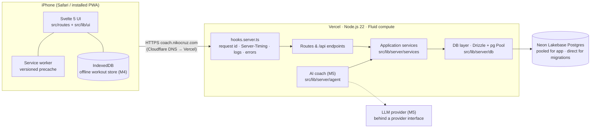

# Architecture

Performance Coach is a **single deployable SvelteKit application** backed by **PostgreSQL**. One
codebase serves the mobile web app (SSR + hydration + service worker), the JSON API under
`/api`, and — from Milestone 5 — the AI coach's server-side orchestration. There are no
microservices: one user, one app, one database (PRD §14).

Decisions and their alternatives are recorded as ADRs in [`docs/adr/`](adr/README.md).

## System overview



## Runtime request flow

1. Cloudflare DNS (DNS-only CNAME) resolves `coach.nikocruz.com` to Vercel; Vercel terminates TLS
   and serves immutable assets from its CDN (`/_app/immutable/*`, `cache-control: immutable`).
2. Dynamic requests run in one Node.js function (adapter-vercel). `hooks.server.ts`:
   - validates the environment once at startup (`init` → `getEnv()`; zod),
   - assigns a request id (`x-request-id` / `x-vercel-id` or a UUID) and opens an
     `AsyncLocalStorage` request context,
   - resolves the route, then adds `Server-Timing` (`db;dur=…`, `total;dur=…`, measured to the
     first byte), `x-request-id` and security headers incl. HSTS, and writes one JSON access-log
     line (SvelteKit itself adds the nonce-based Content-Security-Policy, `csp` in
     `vite.config.ts`; see docs/deployment.md),
   - `handleError` logs unexpected errors and records them in `app_errors`; streamed load
     failures are recorded by the load itself (`kind: streamed`).
   - Static and prerendered files never reach the hooks (CDN / `sirv`).
3. Routes call **services** (use-cases). Services call **repositories** in the DB layer, which
   use a small `pg.Pool` (reused across Fluid-compute invocations, `attachDatabasePool`).
4. The browser hydrates, registers the service worker, and lazily loads `web-vitals`, which
   beacons Core Web Vitals to `POST /api/vitals`.

## Module boundaries

Folders are layers. Allowed dependencies point inwards. Every "Must not import" entry below is
**enforced by ESLint** (`no-restricted-imports` rules in `eslint.config.js`, one block per row;
`pnpm lint` fails on a violation). "May import" is guidance, not a rule.

| Folder                          | Responsibility                                                           | May import                                     | Must not import                                         |
| ------------------------------- | ------------------------------------------------------------------------ | ---------------------------------------------- | ------------------------------------------------------- |
| `src/lib/domain/`               | Pure, isomorphic training math (units, e1RM, RPE, plates, load). No I/O. | nothing outside itself                         | server, client, ui, Svelte/Kit, `node:*`, drivers       |
| `src/lib/server/db/`            | Drizzle schema, pool/client, repositories, migration helpers             | `domain`, `server/env`, `server/observability` | services, agent, ui, client, SvelteKit                  |
| `src/lib/server/services/`      | Application use-cases shared by routes **and** the agent                 | `db`, `domain`, `observability`                | agent, ui, client, SvelteKit                            |
| `src/lib/server/agent/`         | AI coach: provider interface, tools, orchestration (scaffold in M1)      | `services`, `domain`                           | `db` (tools go through services), ui, client, SvelteKit |
| `src/lib/server/auth/`          | Passkey auth & sessions (scaffold in M1; M2)                             | `services`, `db`                               | ui, client                                              |
| `src/lib/server/observability/` | Logger, request context, Server-Timing helpers (a leaf)                  | Node built-ins only                            | db, services, agent, auth, ui, client, SvelteKit        |
| `src/lib/client/`               | Browser-only code: RUM, preferences, offline store/sync (M4)             | `domain`                                       | server, ui                                              |
| `src/lib/ui/`                   | Design-system primitives, tokens, fonts, icons                           | `domain` (types)                               | server                                                  |
| `src/routes/`, `src/hooks*`     | Pages, layouts, `/api` endpoints, request hooks                          | everything above                               | `server/db`, `pg`, `drizzle-orm` (call a service)       |

SvelteKit additionally refuses to bundle any `server/` module into client code.

### Why services sit between routes and the database

The coach (M5) must be able to do everything the UI can — read history, propose changes,
record a review — **through the same code paths**, with the same validation. Putting use-cases
in `services/` (not in route files) makes the agent's tools thin adapters over services, keeps
routes thin, and makes business logic testable without HTTP. Repositories accept an `Executor`
(the database _or_ a transaction), so services decide transaction boundaries and integration
tests can wrap each test in a rolled-back transaction.

## Data

- **PostgreSQL 16+** everywhere: Neon Lakebase Postgres in production/preview, local Postgres 16
  in development, tests and CI (service container).
- **Drizzle ORM** schema in `src/lib/server/db/schema/`; **committed SQL migrations** in
  `drizzle/` generated by `pnpm db:generate` and applied by `pnpm db:migrate`
  (`scripts/db-migrate.ts`, advisory-locked, direct connection). `drizzle-kit push` is never used.
- Connections: `DATABASE_URL` (pooled, Neon `-pooler` host) for the app; `DATABASE_URL_UNPOOLED`
  (direct) for migrations and backups.
- M1 tables: `app_errors` (server incidents) and `web_vitals` (RUM, attributed per screen via
  `path` + `route_id`). CI's `pnpm db:drift` fails when the schema changes without a committed
  migration. The training data model
  (profile, goals, programs, cycles, workouts, sets, sessions, decisions) lands in M3 with
  history-preserving, timestamped records (PRD §9).

## Frontend

- Svelte 5 (runes) with SSR for every app route; client-side navigation afterwards; view
  transitions between tabs.
- Mobile-first shell (`src/routes/(app)/+layout.svelte`) with a fixed bottom navigation,
  safe-area insets and `viewport-fit=cover`. Dark is the designed default; light and "auto"
  are supported (`docs/design-system.md`).
- PWA: web manifest, PNG/SVG icons, and a SvelteKit service worker
  (`src/service-worker/index.ts`) that precaches the versioned build + static assets, deletes old
  caches and claims open pages on activate (so the first visit is already controlled), and
  serves navigations from the network with the prerendered `/offline` screen as the fallback.
  It **never stores dynamic HTML, `__data.json` or `/api/*`**: pages are `private, no-cache`
  because they carry personal data, and a stored copy would outlive sign-out and show stale
  state as live. Offline workout data (M4) will live in IndexedDB, owned by the app.
- Offline UX: the `/offline` screen renders inside the app shell (tabs keep working), and
  `src/hooks.client.ts` marks network failures during client-side navigation (`__data.json`
  fetch errors) as `offline`, so `src/routes/ErrorView.svelte` shows the designed offline state
  with the nav instead of a 500. A connectivity notice appears in the shell while offline.
  Covered by `e2e/offline.e2e.ts`.
- Code splitting per route; heavy, interaction-only UI (e.g. the plate calculator) is loaded on
  intent. Budgets are enforced in CI (`docs/performance.md`).

## Observability

| Signal           | Where                                                         |
| ---------------- | ------------------------------------------------------------- |
| Access logs      | one JSON line per request (stdout → Vercel logs)              |
| Request timing   | `Server-Timing` header (`db`, `total`)                        |
| Errors           | JSON log + `app_errors` row with request id and stack         |
| Real-user vitals | `web_vitals` table (LCP, INP, CLS, TTFB, FCP; p75 on Profile) |
| Health           | `GET /api/health` → `{ ok, db, version, dbLatencyMs }`        |

Sentry can be added later behind the optional `SENTRY_DSN` variable; nothing requires it.

## Environments

`development` (local `vite dev`), `test` (Vitest + Playwright against local/CI Postgres),
`preview` (Vercel preview deployments + a Neon branch), `production` (Vercel production +
Neon main branch). See `docs/environment.md`.

## Repository layout

```
.github/            CI, deploy and backup workflows; PR template; Dependabot
docs/               product requirements, architecture, ADRs, guides
drizzle/            committed SQL migrations + drizzle-kit snapshots
e2e/                Playwright specs and global setup
scripts/            db setup/migrate/reset, budgets, Lighthouse, icons, restore, Vercel build guard
src/
  hooks.server.ts   request pipeline (timing, logs, errors, headers)
  service-worker/   PWA service worker (own tsconfig)
  lib/{domain,server,client,ui}
  routes/           pages and /api endpoints
static/             manifest, icons, robots.txt
tests/integration/  Vitest integration tests (real Postgres)
neon.ts             Neon config-as-code (Postgres only)
vercel.json         Vercel project config: no Git deploys of main, production build guard
```
