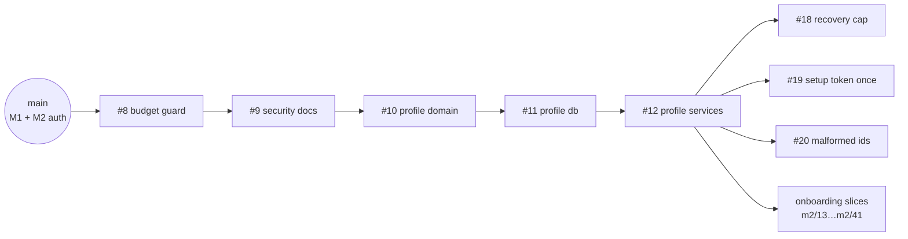

# Performance Coach: handoff (paused 2026-11-05, ~23:45 UTC)

This is everything needed to pick up the build somewhere else. The full product spec is
`docs/product-requirements.md` on `main`.

**The owner's working rules:** every change lands as a small, atomic PR, green on its own, ideally
600 lines or fewer of non-test code. Merge each PR when it is green, with a merge commit. Ask first
only before deleting real data, spending money beyond the free plans, or touching anything outside
this project.

## Where things stand

| Area                                                             | State                                                      |
| ---------------------------------------------------------------- | ---------------------------------------------------------- |
| **M1** Foundation                                                | ✅ Merged (#1)                                             |
| CI fixes                                                         | ✅ Merged (#15, #16, #17); details below                   |
| **M2** auth: tables, primitives, services, scripts, sign-in      | ✅ Merged (#2–#7): `main` has deny-by-default passkey auth |
| **M2** budget guard, security docs, profile domain, db, services | 🟢 Open, green or nearly (#8–#12): merge in order          |
| **M2** security review fixes                                     | 🟡 3 PRs green (#18–#20), 3 branches pushed, 8 not started |
| **M2** onboarding, Profile editing, Today states                 | 📋 Planned as 29 slices (`briefs/m2-onboarding-plan.json`) |
| **M2** production cutover (turn on coach.nikocruz.com)           | ⏳ After the security fixes and onboarding                 |
| **M3–M7, M9**                                                    | ⏳ Briefs in `briefs/`                                     |
| **M8** councils                                                  | ⏳ `workflows/councils.js` (pass the bar privately)        |

Production is still off: the `vercel.json` guards stay in place until the cutover PR.



## Next steps, in order

### 1. Merge the rest of the M2 stack

Merge #8, #9, #10, #11, #12 in that order. After each merge, set the next PR's base to `main`.
At pause, all were green except #10 (Lighthouse running) and #12 (E2E running). Every head already
has the CI fixes from `main` merged in.

Then retarget #18, #19 and #20 to `main` and merge them. They are siblings, not a stack, so
merge `main` into each before merging if GitHub reports a conflict.

Close #14 (the old WIP onboarding PR) once the onboarding slices replace it.

### 2. Finish the security review fixes

An independent review of the M2 stack found no critical issue: nothing personal is reachable
without a session, and there is no auth bypass, open redirect or CSRF hole. It found one major
issue and 12 minor ones (13 in all); finding 14 has two informational parts, which makes the 15
fix items below. Every item has a full description, failure scenario and fix in
`workflows/m2-security-fixes.js` (the `F` map). Each fix needs a regression test that fails without the fix.

| Fix                                                      | Branch                                           | State                                  |
| -------------------------------------------------------- | ------------------------------------------------ | -------------------------------------- |
| **Major:** one IP can block all recovery-code sign-ins   | `fix/m2-recovery-global-cap`                     | PR #18, green                          |
| An old setup link works again after `auth:reset-owner`   | `fix/m2-setup-token-single-use`                  | PR #19, green (adds a migration)       |
| Malformed ids return 500 instead of "not found"          | `fix/m2-malformed-ids-not-found`                 | PR #20, green                          |
| A revoked recovery session can still upgrade             | `fix/m2-recovery-upgrade-revoked`                | pushed, verify, then open a PR         |
| Test routes enabled by env misconfiguration on Vercel    | `fix/m2-test-routes-build-flag`                  | pushed, verify, then open a PR         |
| Changing a goal's status undoes a concurrent edit        | `fix/m2-goal-status-no-lost-update`              | pushed, verify, then open a PR         |
| Rate-limited sign-out leaves the session live            | `fix/m2-signout-always-revokes`                  | not started                            |
| Rate-limited `/setup` answers 500                        | `fix/m2-setup-rate-limit-status`                 | not started                            |
| Rate limits per full IPv6 address; counters never pruned | `fix/m2-rate-limit-ipv6-prune`                   | not started                            |
| Recovery sessions hidden; activity feed floodable        | `fix/m2-recovery-sessions-visible`               | not started                            |
| Preview DB reset copies production data (docs)           | `docs/m2-preview-branch-without-production-data` | not started                            |
| Body weight dated by UTC day                             | `fix/m2-body-weight-local-day`                   | not started (migration, after #19's)   |
| Concurrent section saves give a 500                      | `fix/m2-section-saves-serialize`                 | not started                            |
| Onboarding accepts unknown and required-step skips       | `fix/m2-onboarding-progress-validation`          | not started                            |
| **Step-up re-authentication** for sensitive actions      | `feat/m2-step-up-reauthentication`               | not started (migration, last; largest) |

The three pushed branches were implemented, but their adversarial verification had not finished.
Run the verifier (step 2 of `doFinding` in the script) before opening their PRs.

Keep migrations in order: setup token (#19), then body-weight time zone, then step-up. The journal
order is enforced by a unit test.

### 3. Build onboarding, Profile editing and Today from the plan

`briefs/m2-onboarding-plan.json` has 29 slices (`m2/13`…`m2/41`). Two independent planners wrote
it, and a synthesizer checked both against real builds and budgets. Read `wipAssessment` first.
Key decisions:

- **One dynamic route each** for onboarding (`/onboarding/[[step]]`) and Profile editing
  (`/(app)/profile/[section]`), with **no param matchers**. Editors load lazily from a registry.
  - Per-step routes break the 60 KB initial-JS budget on every step (measured at 63–69 KB).
  - Every route node also costs every route bytes through the entry's `__vite__mapDeps`.
  - `/profile/security` has only 0.4 KB of headroom. Every slice pastes its budget row.
- **Order:**
  1. Budget accounting and test fixes.
  2. Input primitives.
  3. The JSON save path.
  4. Profile editing, one section per slice.
  5. The onboarding flow, then save-on-leave, then resume.
  6. Review.
  7. The Today states.
  8. Docs.
- **Drop slice `m2/16`:** the security fix "onboarding progress validation" covers it.
- The WIP code lives on branch `m2/12-onboarding` (commit `d8bfded`). Slices take files from it
  and fix the bugs listed in `wipAssessment`.

Start after the profile-track security fixes are merged (ids, goal status, section saves,
onboarding validation, body-weight time zone), so the slices build on fixed services.

### 4. Production cutover (its own PR)

Follow `briefs/m2.json`, step 3:

1. Remove the `vercel.json` guards.
2. Add the post-deploy smoke workflow.
3. Generate a token and hash with `pnpm auth:setup-token`. Set the hash as `OWNER_SETUP_TOKEN_HASH`
   in Vercel → Production, and keep the token private.
4. Merge, then open `https://coach.nikocruz.com/setup?token=<token>` on the iPhone to register the
   passkey, and save the recovery codes.

### 5. M3 → M7, then M8 and M9

Use the briefs in `briefs/`. Each milestone lands as small stacked PRs.

- **M5 (the AI coach):** use the `claude-api` skill. `ANTHROPIC_API_KEY` is set in Vercel
  Production and in the cloud environment "Home".
- **M8:** run an early council pass after M4, then `workflows/councils.js` until every reviewer
  meets the bar. The bar is in the original spec and is never stored in the repo; pass it as
  `args.bar`.
- **M9:** backups via Vercel Cron → encrypted export → Vercel Blob, plus the restore drill and the
  final reports.

## Infrastructure

| Piece             | State                                                                                                                                                                                                                      |
| ----------------- | -------------------------------------------------------------------------------------------------------------------------------------------------------------------------------------------------------------------------- |
| GitHub            | `TheCruzControll/performance-coach` (public)                                                                                                                                                                               |
| Vercel            | Project `performance-coach` (`prj_ofpkwho7FKmRXNr9Bem9phaD2AVN`), team `thecruzcontrolls-projects`, Hobby. Every PR gets a preview. Node 22, functions in `pdx1`. Production is off until the cutover                      |
| Neon              | Project `red-rain-59499468`, `aws-us-west-2`, Postgres 18, free plan. Branches `production` and `preview`. The preview branch is shared by every PR preview; recreate it schema-only, never copy production data into it   |
| Env vars (Vercel) | `DATABASE_URL`, `DATABASE_URL_UNPOOLED` (Production and Preview), `ANTHROPIC_API_KEY` (Production). **Missing:** `OWNER_SETUP_TOKEN_HASH` (at cutover), and for M9 `CRON_SECRET`, `BACKUP_ENCRYPTION_KEY` and a Blob store |
| Domain            | `coach.nikocruz.com` attached and verified; Cloudflare `CNAME coach → e8ec158fe2c98016.vercel-dns-017.com`, DNS only                                                                                                       |
| CI                | The E2E job runs on `ubuntu-24.04`, with Playwright's system packages cached (`~/.cache/apt-archives`). The other jobs run on `ubuntu-latest`                                                                              |
| Cloud environment | "Home" allows `cdn.playwright.dev`, so WebKit can be installed locally: `pnpm exec playwright install webkit && pnpm exec playwright install-deps webkit`                                                                  |

Details are in `docs/deployment.md`.

## How to work on it

```sh
pnpm install && pnpm db:setup       # Node 22, pnpm 10, local Postgres 16+
pnpm check && pnpm lint && pnpm test:unit && pnpm test:integration
pnpm build && pnpm build:node && pnpm budgets
pnpm test:e2e                       # Chromium; E2E_WEBKIT=1 adds WebKit (CI always runs both)
# Running suites in parallel? Give each its own databases and port:
#   TEST_DATABASE_URL=…/coach_x_test E2E_DATABASE_URL=…/coach_x_e2e E2E_PORT=4373
```

Workflow scripts (Claude Code workflows) are in `workflows/`. Replace the placeholder commit-trailer
lines and the hard-coded scratch paths with your environment's before you run one.

- `m2-security-fixes.js`: parallel tracks (auth; setup then step-up; profile). For each finding:
  implement, then an adversarial verifier that reverts the fix to prove the test fails, then
  fixes, then publish. Remove the findings that are already done before re-running it.
- `m2-onboarding-plan.js`: the planner that produced the slice plan.
- `milestone-build.js`: implement → verifier and critic → fix rounds, for a brief in `briefs/`.
- `m2-stack-review.js`: the security review prompt that found the issues above.
- `councils.js`: 5 performance and 5 design reviewers, evaluating blind, until all meet `args.bar`.

## Lessons learned

**Process**

- **Small PRs from the start.** Splitting work after the fact found intermediate states that had
  never been green.
- **You can't re-run CI jobs from a cloud session** (403). A real fix pushed, or `main` merged into
  the branch, re-runs it. Never push an empty commit to trigger CI.

**Local environment**

- **Give every git worktree its own `node_modules`.** SvelteKit 3 writes generated types into
  `node_modules/$app`, so a symlinked `node_modules` type-checks against another checkout's routes.
- **The local Postgres stops when the worker restarts.** Run `pg_ctlcluster 16 main start`.
  Playwright is pinned to 1.63.0.

**CI and test failures**

- **WebKit reports every cancelled load as a failure.** `src/lib/client/leaving.ts` keeps the error
  reporters quiet while a page is being left. Startup stylesheets that were inlined are fetched
  again by the root layout's imports.
- **`ubuntu-latest` is Ubuntu 26.04.** Its Azure mirror served WebKit's packages at ~50 KB/s, which
  is why the E2E job is pinned to 24.04.
- **e2e rate limits.** Every spec registers passkeys from one owner session, whose `register`
  bucket allows 20 hits per 15 minutes. Account-wide specs reset that counter.
- **The virtual authenticator answers autofill at once.** A signed-out device that still holds its
  passkey signs itself back in, so take the passkey away before asserting a sign-out.

**Branch housekeeping**

- **The git proxy refuses branch deletion.** Delete stale branches in the GitHub UI. Candidates:
  - superseded `m2/*` names from before the regroup;
  - `feat/m2-auth-onboarding`, `wip/m2-onboarding-ui`;
  - merged `fix/leaving-page-errors`, `fix/ci-playwright-install`, `fix/ci-cache-apt-packages`.
