# Performance Coach: handoff (paused 2026-11-05, ~20:00 UTC)

This is everything needed to pick up the build somewhere else. The full product spec is
`docs/product-requirements.md` on `main`.

## Where things stand

| Milestone                                              | State                                                             | Where                                |
| ------------------------------------------------------ | ----------------------------------------------------------------- | ------------------------------------ |
| **M1** Foundation & infrastructure                     | ✅ Merged                                                         | `main` (PR #1)                       |
| **M2** Passkey auth                                    | 🟡 Built and regrouped into 8 small PRs (#2–#9), open, not merged | `m2/01…08`                           |
| **M2** Training-profile data and services              | 🟡 Built, 3 PRs (#10–#12), open, not merged                       | `m2/09…11`                           |
| **M2** Onboarding UI, Profile editing, Today states    | 🟠 In progress (WIP commit, not green yet)                        | branch `m2/12-onboarding`, no PR     |
| **M2** Production cutover (turn on coach.nikocruz.com) | ⏳ Not started                                                    | brief: `briefs/m2.json` step 3       |
| **M3–M7, M9**                                          | ⏳ Not started; briefs written                                    | `docs/handoff/briefs/m3…m9.json`     |
| **M8** Performance & design councils                   | ⏳ Not started; workflow written                                  | `docs/handoff/workflows/councils.js` |

```mermaid
flowchart LR
  main((main<br/>M1 merged)) --> p2[#2 auth db + env]
  p2 --> p3[#3 auth primitives]
  p3 --> p4[#4 auth services]
  p4 --> p5[#5 setup/reset scripts]
  p5 --> p6[#6 form UI primitives]
  p6 --> p7[#7 sign-in, guard, screens, e2e]
  p7 --> p8[#8 budget guard]
  p8 --> p9[#9 security docs]
  p9 --> p10[#10 profile domain]
  p10 --> p11[#11 profile db]
  p11 --> p12[#12 profile services]
  p12 --> wip[m2/12-onboarding<br/>WIP, no PR]
```



### The open PR stack (#2–#12)

Each PR is based on the one before it, so its diff shows only its own change. The final tree
matches the code the M2 implementation agent built and ran green, apart from `.gitattributes`.

| PR  | Branch                     | What                                                                                 | Local check before pause                                                               |
| --- | -------------------------- | ------------------------------------------------------------------------------------ | -------------------------------------------------------------------------------------- |
| #2  | `m2/01-auth-schema`        | auth tables, env, deps, `.gitattributes`                                             | CI ran                                                                                 |
| #3  | `m2/02-auth-primitives`    | tokens, cookies, CSRF, relying party, return paths                                   | ✅ check, lint, unit, integration                                                      |
| #4  | `m2/03-auth-services`      | WebAuthn ceremonies, setup, recovery, sessions, rate limits                          | ✅ same, 51 integration tests                                                          |
| #5  | `m2/04-auth-scripts`       | `pnpm auth:setup-token`, `pnpm auth:reset-owner`, migration 0003                     | ✅ same                                                                                |
| #6  | `m2/05-form-primitives`    | TextField, Notice, RecoveryCodes                                                     | ✅ check, lint                                                                         |
| #7  | `m2/06-sign-in`            | deny-by-default, route table, sign-in/setup/Security screens, lazy passkey code, e2e | ✅ check, lint, unit, integration, budgets · ⚠️ e2e 69/71 under heavy load (see below) |
| #8  | `m2/07-security-lazy-load` | budget guard: WebAuthn library never in initial JS                                   | ✅                                                                                     |
| #9  | `m2/08-security-docs`      | `docs/security.md`, ADR 0006 accepted                                                | ✅                                                                                     |
| #10 | `m2/09-profile-domain`     | profile catalogue, types, schemas                                                    | ✅                                                                                     |
| #11 | `m2/10-profile-db`         | migration 0004 + repositories                                                        | ✅                                                                                     |
| #12 | `m2/11-profile-services`   | profile services + integration tests                                                 | ✅ (84 integration tests)                                                              |

**CI status:** all 11 branches were force-pushed with the fixed regrouping just before the
pause, so CI is running or has run on the new heads. Check each PR's checks before merging.

## Next steps, in order

1. **Independent review of the auth stack.** It never ran to completion: the security and
   correctness review workflow was stopped. Re-run `workflows/m2-stack-review.js` (verifier plus
   adversarial critic) against `m2/11-profile-services` in its own worktree, after updating its
   paths. It covers real WebAuthn ceremonies, the deny-by-default sweep, setup-token replay,
   session rotation and expiry, rate-limit bypass via spoofed IP headers on Vercel, test-only
   routes being impossible in production, and nothing sensitive in logs. Fix findings as small
   PRs.
2. **Get the stack green and merge it in order** (#2 → #12). Merge with a **merge commit**,
   not squash, so the stacked branches stay consistent. After each merge, retarget the next PR's
   base to `main` (or merge them in order and GitHub retargets automatically when the base branch
   is deleted).
   - #7 had 2 e2e tests that timed out locally while three e2e suites shared 4 CPUs (the plate
     calculator a11y sheet, and the "Passkey added" toast in the sessions test). Both passed on
     a repeat run. If CI fails them, root-cause them (the earlier NumberStepper failure looked
     like noise and was a real race); never retry them to green.
3. **Finish onboarding** on `m2/12-onboarding` (rebased on #12). The last commit is a **WIP
   commit** (`wip(onboarding): …`) that is not green yet. It holds new form primitives
   (ChoiceGroup, DayPicker, NumberField, TagInput, TextArea, Toggle), `src/routes/onboarding/`,
   profile form helpers and `src/routes/profile-forms.server.ts`. The two commits before it
   are complete: per-route budget accounting, and a hydration wait in tests. Split the WIP into
   small green commits and PRs: primitives → onboarding flow → onboarding e2e → Profile editing
   → Today states. The acceptance list is in `briefs/m2.json` step 2.
4. **Production cutover**, as its own PR (`briefs/m2.json` step 3):
   - remove the `vercel.json` guards
   - add the post-deploy smoke workflow
   - set **`OWNER_SETUP_TOKEN_HASH`** in Vercel → Production (generate it with
     `pnpm auth:setup-token`; keep the token itself private)
   - merge, then open `https://coach.nikocruz.com/setup?token=<token>` on the iPhone to register
     the passkey and save the recovery codes
5. **M3 → M7** using the briefs, one milestone at a time, **as small atomic PRs**: each commit
   green, about 600 lines or less of non-test code, stacked PRs.
6. **Early council pass after M4**, then **M8** with `workflows/councils.js`. The stopping
   criterion is in your original spec and is deliberately kept out of the repo: pass it as
   `args.bar`.
7. **M9**: security review, automated backups (Vercel Cron → encrypted export → Vercel Blob,
   because Neon's free plan has no scheduled snapshots), the restore drill, final QA, and the
   Performance and Design reports.

## Infrastructure (already set up)

| Piece              | State                                                                                                                                                                                                                                        |
| ------------------ | -------------------------------------------------------------------------------------------------------------------------------------------------------------------------------------------------------------------------------------------- |
| GitHub             | `TheCruzControll/performance-coach` (public)                                                                                                                                                                                                 |
| Vercel             | Project `performance-coach` (`prj_ofpkwho7FKmRXNr9Bem9phaD2AVN`), team `thecruzcontrolls-projects`, Hobby. Git integration on; every PR gets a preview. Node 22, functions in `pdx1`                                                         |
| Deploys            | `scripts/vercel-build.sh` migrates that environment's Neon branch over `DATABASE_URL_UNPOOLED`, then builds. **Production is still off** (`vercel.json` guards) until the cutover PR                                                         |
| Neon               | Project `red-rain-59499468`, `aws-us-west-2`, Postgres 18, free plan. Branches `production` and `preview` (shared by all previews; reset it from production if PR migrations collide)                                                        |
| Env vars on Vercel | `DATABASE_URL` and `DATABASE_URL_UNPOOLED` for Production and Preview; `ANTHROPIC_API_KEY` for Production only. **Missing:** `OWNER_SETUP_TOKEN_HASH`, plus later the M9 backup vars `CRON_SECRET`, `BACKUP_ENCRYPTION_KEY` and a Blob store |
| Domain             | `coach.nikocruz.com` attached and verified; Cloudflare `CNAME coach → e8ec158fe2c98016.vercel-dns-017.com`, DNS only                                                                                                                         |

Details are in `docs/deployment.md`.

## How to work on it

```sh
pnpm install && pnpm db:setup       # Node 22, pnpm 10, local Postgres 16+
pnpm check && pnpm lint && pnpm test:unit && pnpm test:integration
pnpm build && pnpm build:node && pnpm budgets
pnpm test:e2e                       # Chromium locally; CI adds WebKit
# Running two suites at once? Isolate them:
#   TEST_DATABASE_URL=…/coach_x_test E2E_DATABASE_URL=…/coach_x_e2e E2E_PORT=4373
```

**Workflow scripts** (Claude Code workflows, in `docs/handoff/workflows/`):

- `m2-stack-review.js`: independent verification and security review of the M2 stack.
- `milestone-build.js`: implement → independent verifier and adversarial critic → fix rounds.
  Pass a brief from `briefs/` as `args`. Update the hard-coded `REPO` and `SCRATCH` paths and
  the commit trailers to match the new environment.
- `councils.js`: 5 performance and 5 design reviewers, evaluating blind; a chair prioritises,
  implementers fix, and the loop repeats. Pass `args.bar` privately.

## Lessons learned (save the next person time)

- **Small PRs from the start.** Have agents commit atomic, PR-sized, green commits. Splitting
  after the fact found intermediate states that were never green: formatting fixes landing
  later, a route table that referenced routes added later, and a lazy load needed to stay
  inside the budget.
- **WebKit only runs in CI.** It found real bugs in M1:
  - a cancelled stylesheet raising `vite:preloadError`
  - an INP attribution test that assumed which interaction was the worst
  - a NumberStepper `select()` refocusing the input in a late animation frame
- **Playwright is pinned to 1.63.0.** Never run `playwright install` in the cloud container.
- **The git proxy in Claude cloud sessions refuses branch deletion.** These stale branches can
  be deleted in the GitHub UI: `m2/02-auth-services`, `m2/03-auth-scripts`, `m2/04-form-primitives`,
  `m2/05-sign-in`, `m2/06-security-lazy-load`, `m2/07-security-docs`, `m2/08-profile-schema`,
  `m2/09-profile-services`, `feat/m2-auth-onboarding` and `wip/m2-onboarding-ui` (both
  superseded by the stack).
- **The local Postgres in the cloud container stops when the worker restarts.** Run
  `pg_ctlcluster 16 main start`.
- **Order matters across PRs.** Drizzle migrations must stay in journal order (a unit test
  enforces this), and the shared `preview` Neon branch can skip out-of-order migrations.
